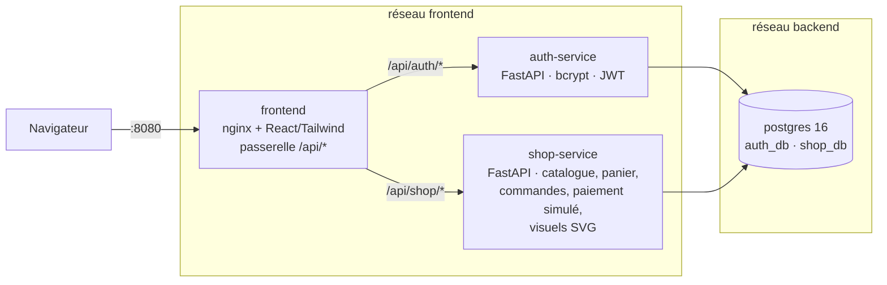

# NovaShop — boutique en ligne fictive en microservices

Site e-commerce de démonstration spécialisé en **body pillows de personnages de jeu vidéo** :
page d'accueil, catalogue filtrable, fiches produit (recto / verso), panier, paiement par carte (simulé)
et suivi des commandes. **Aucun paiement réel.**

Les personnages sont **originaux** (dragonne, paladin, nécromancienne, cyber-ninja, slime, héros 8-bit…),
adultes et entièrement habillés. Leurs illustrations sont générées en SVG par shop-service à partir
d'une « fiche d'apparence » stockée en base (`products.art`), voir `services/shop-service/app/art.py`.

## Comptes de démonstration

Créés automatiquement au démarrage d'auth-service (désactivable avec `SEED_DEMO_USERS=false`) :

| Nom          | Email              | Mot de passe |
|--------------|--------------------|--------------|
| Léo Martin   | `leo@novashop.fr`  | `Demo1234`   |
| Inès Durand  | `ines@novashop.fr` | `Demo1234`   |

Sur la page de connexion, un clic sur un compte de démo suffit pour se connecter.

## Architecture



| Service        | Rôle                                                         | Port hôte | Base       |
|----------------|--------------------------------------------------------------|-----------|------------|
| `frontend`     | Sert la SPA React et fait **passerelle API** (reverse proxy) | 8080      | –          |
| `auth-service` | Inscription, connexion, émission des JWT                     | 8001      | `auth_db`  |
| `shop-service` | Catalogue, panier, commandes, paiement fictif                | 8002      | `shop_db`  |
| `postgres`     | Une instance, **une base + un rôle par service**             | 5433      | –          |
| `adminer` (opt.)| Interface web Postgres (`--profile tools`)                  | 8081      | –          |

Choix de conception :

- **Database-per-service** : `auth_user` ne peut pas lire `shop_db` et inversement. Pas de clé étrangère
  entre services : `cart_items.user_id` / `orders.user_id` référencent l'id de l'utilisateur d'auth-service.
- **Auth stateless** : auth-service signe un JWT HS256 (`sub`, `email`, `name`, `exp`, `iss`) ;
  shop-service le vérifie **localement** avec le secret partagé, donc sans appel réseau par requête.
- **Le serveur fait foi** : prix, stocks, frais de port et totaux sont toujours recalculés par shop-service,
  jamais envoyés par le navigateur. Les lignes de commande figent le nom et le prix au moment de l'achat.
- **Pas de survente** : au paiement, les produits sont verrouillés (`SELECT … FOR UPDATE`, triés par id
  pour éviter les interblocages). Deux clients ne peuvent pas acheter le dernier exemplaire en même temps.
  Le panier est verrouillé lui aussi, donc un double clic sur « Payer » ne crée pas deux commandes.
- **Panier hybride** : un visiteur non connecté a un panier en `localStorage`, chiffré par `POST /cart/quote`.
  À la connexion, il est fusionné dans le panier serveur (`POST /cart/merge`).
- **Isolation réseau** : Postgres n'est que sur le réseau `backend` ; le frontend ne peut pas l'atteindre.
- Images Python non-root avec `HEALTHCHECK` ; `depends_on: service_healthy` orchestre le démarrage.
- Le catalogue de démonstration (5 univers, 17 body pillows + 4 accessoires) est inséré automatiquement
  au premier démarrage, ainsi que les comptes de démo.

## Démarrage

Prérequis : Docker Desktop.

```bash
cp .env.example .env          # optionnel : toutes les variables ont une valeur par défaut
docker compose up -d --build
```

| URL                                    | Contenu                    |
|----------------------------------------|----------------------------|
| http://localhost:8080                  | Boutique                   |
| http://localhost:8080/api/shop/docs    | Swagger shop-service       |
| http://localhost:8080/api/auth/docs    | Swagger auth-service       |
| `/api/shop/redoc`, `/api/auth/redoc`   | Documentation ReDoc        |

Les docs sont aussi accessibles directement sur les ports 8001 et 8002 (ex. http://localhost:8002/api/shop/docs).

**Cartes de test** (date future et CVC quelconques) :

| Numéro                | Résultat                     |
|-----------------------|------------------------------|
| `4242 4242 4242 4242` | Paiement accepté             |
| `4000 0000 0000 0002` | Refusé par la banque (402)   |
| `4000 0000 0000 9995` | Refusé, fonds insuffisants (402) |

Livraison : 4,90 €, offerte dès 50 € (configurable via `SHIPPING_COST` et `FREE_SHIPPING_THRESHOLD`).

### Tester l'API dans Swagger

1. auth-service → `POST /api/auth/register`
2. Bouton **Authorize** : email dans *username*, mot de passe dans *password*
3. Copier l'`access_token` de `POST /api/auth/login`, puis dans shop-service → **Authorize** → coller le jeton
4. `POST /api/shop/cart/items` → `POST /api/shop/orders`

### Commandes utiles

```bash
docker compose ps                      # état et santé des conteneurs
docker compose logs -f shop-service    # logs d'un service
docker compose --profile tools up -d   # + Adminer sur :8081 (serveur : postgres)
docker compose down                    # arrêter
docker compose down -v                 # arrêter ET supprimer les données (le catalogue sera recréé)
```

> Le script `db/init/01-init-databases.sh` ne s'exécute qu'à la **création** du volume. Si vous changez
> les mots de passe des bases, faites `docker compose down -v`.

> Pas de migrations pour l'instant (`create_all`) : après une modification des modèles de shop-service,
> réinitialisez ses tables (le catalogue est recréé au démarrage, les comptes ne sont pas touchés) :
> `docker compose exec postgres psql -U postgres -d shop_db -c "DROP TABLE IF EXISTS order_items, orders, cart_items, products, categories CASCADE; DROP TYPE IF EXISTS order_status;"`
> puis `docker compose restart shop-service`.

## Développement du front sans rebuild

```bash
docker compose up -d postgres auth-service shop-service
cd frontend && npm install && npm run dev   # http://localhost:5173 (proxy Vite → 8001/8002)
```

## Pages du site

| Route            | Page                                                              |
|------------------|-------------------------------------------------------------------|
| `/`              | Accueil : bannière, avantages, catégories, coups de cœur, promotions |
| `/products`      | Catalogue : recherche, catégories, filtres, tri, pagination       |
| `/products/:slug`| Fiche produit : galerie recto / verso, caractéristiques, stock, ajout au panier |
| `/cart`          | Panier : quantités, suppression, seuil de livraison offerte       |
| `/checkout`      | Adresse + paiement par carte (connexion requise)                  |
| `/orders`        | Historique des commandes                                          |
| `/orders/:id`    | Détail, confirmation après achat, annulation                      |
| `/login`, `/register` | Authentification (le panier invité est conservé)             |

## Endpoints

**auth-service** (`/api/auth`)

| Méthode | Route       | Auth | Description                                 |
|---------|-------------|------|---------------------------------------------|
| POST    | `/register` | –    | Créer un compte (mot de passe haché bcrypt) |
| POST    | `/login`    | –    | Form OAuth2 → JWT                           |
| GET     | `/me`       | JWT  | Profil courant                              |
| GET     | `/health`   | –    | Sonde de santé                              |

**shop-service** (`/api/shop`)

| Méthode | Route                        | Auth | Description                                            |
|---------|------------------------------|------|--------------------------------------------------------|
| GET     | `/categories`                | –    | Catégories avec nombre de produits                     |
| GET     | `/products`                  | –    | `category`, `q`, `featured`, `on_sale`, `in_stock`, `sort`, `limit`, `offset` |
| GET     | `/products/{slug}`           | –    | Détail d'un produit                                    |
| POST    | `/cart/quote`                | –    | Chiffrer un panier invité                              |
| GET     | `/cart`                      | JWT  | Mon panier (totaux calculés)                           |
| POST    | `/cart/items`                | JWT  | Ajouter un article (409 si stock insuffisant)          |
| PATCH   | `/cart/items/{product_id}`   | JWT  | Modifier la quantité                                   |
| DELETE  | `/cart/items/{product_id}`   | JWT  | Retirer un article                                     |
| DELETE  | `/cart`                      | JWT  | Vider le panier                                        |
| POST    | `/cart/merge`                | JWT  | Fusionner le panier invité après connexion             |
| POST    | `/orders`                    | JWT  | Payer le panier → commande (402 carte refusée, 409 stock) |
| GET     | `/orders`                    | JWT  | Mes commandes                                          |
| GET     | `/orders/{id}`               | JWT  | Détail d'une commande                                  |
| POST    | `/orders/{id}/cancel`        | JWT  | Annuler (remboursement fictif + remise en stock)       |
| GET     | `/media/{slug}.svg`          | –    | Visuel du produit : `?view=pair` (défaut), `front`, `back` |
| GET     | `/health`                    | –    | Sonde de santé                                         |

## Arborescence

```
.
├── docker-compose.yml
├── .env.example
├── db/init/01-init-databases.sh       # crée auth_db / shop_db + rôles dédiés
├── services/
│   ├── auth-service/                   # FastAPI : config, database, models, schemas, security, routes
│   │   └── app/seed.py                 # comptes de démonstration
│   └── shop-service/
│       └── app/
│           ├── models.py               # Category, Product, CartItem, Order, OrderItem
│           ├── seed.py                 # catalogue de démonstration + fiches d'apparence
│           ├── art.py                  # générateur d'illustrations SVG (housses recto / verso)
│           ├── cart_service.py         # règles du panier (stock, plafonds, frais de port)
│           ├── order_service.py        # paiement du panier, annulation (verrous)
│           ├── payment.py              # prestataire de paiement simulé
│           └── routers/                # catalog.py, cart.py, orders.py, media.py
└── frontend/                           # Vite + React 18 + Tailwind 3, servi par nginx
    ├── nginx.conf                      # SPA + reverse proxy /api/*
    └── src/{pages,components,context,utils}
```

## Pistes d'évolution

- Extraire le paiement dans un **payment-service** dédié (appel HTTP ou événement depuis shop-service)
- Migrations **Alembic** à la place de `create_all`
- Back-office admin (gestion des produits et des stocks, rôle dans le JWT)
- Codes promo, liste de souhaits, avis clients
- JWT **RS256** + endpoint JWKS ; refresh tokens ; limitation du débit sur `/login`
- Événements asynchrones (RabbitMQ ou Redis Streams) : email de confirmation, mise à jour des stocks
- Tests (pytest + testcontainers), CI, puis déploiement Kubernetes
