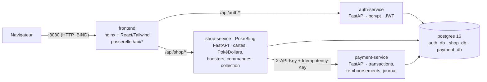
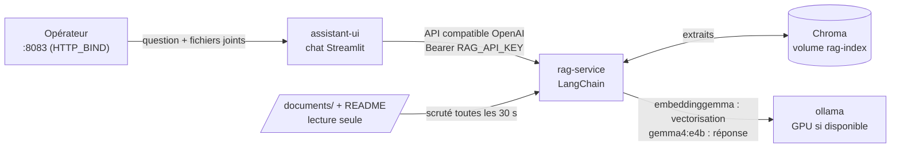
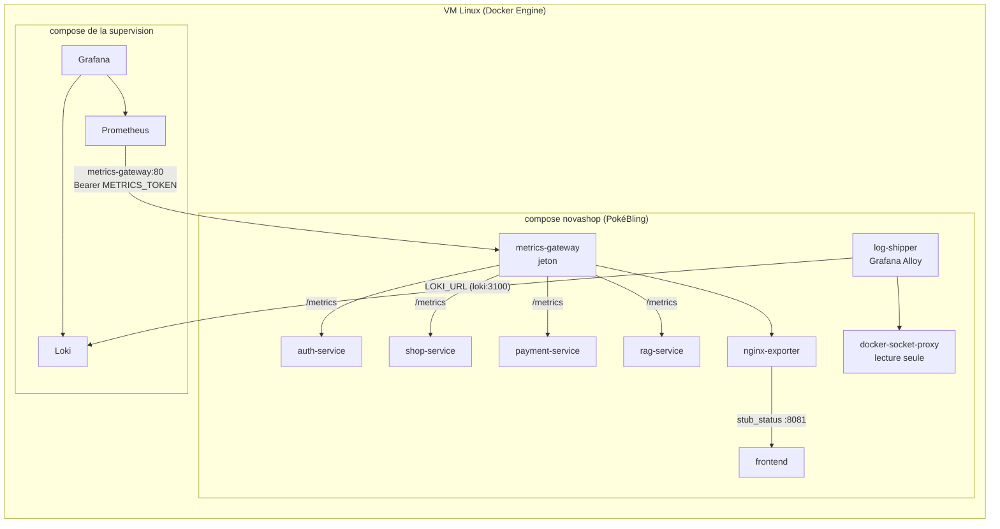

# Plateforme de paiement fictive et sa boutique marchande PokéBling

Démonstrateur du workshop **PROJECT RESILIENCE-ALPHA** : une **plateforme de paiement** fictive
(`payment-service`) qui encaisse les paiements par carte pour le compte de marchands, et un marchand
de démonstration, la boutique en ligne **PokéBling** (anciennement NovaShop), qui génère des transactions
réelles de bout en bout. **Aucun paiement réel, aucune donnée bancaire réelle.**

- **payment-service** est le système critique : transactions, remboursements, journal des opérations.
  C'est lui qui est attaqué, surveillé et rétabli. La preuve de reprise est une nouvelle transaction acceptée.
- **PokéBling** est un marchand partenaire : boutique de **cartes Pokémon numériques**. On y achète, par carte
  bancaire, des cartes à l'unité (cher) ou des **PokéDollars** (monnaie virtuelle) ; les PokéDollars servent à
  ouvrir des **boosters**, tirés au sort par le serveur ; chaque client a sa **collection**.

Les noms et caractéristiques des 1 797 cartes (16 sets : Set de Base, Jungle, Fossile ; toute la série Noir &
Blanc, de Noir & Blanc à Explosion Plasma ; 151, Évolutions Prismatiques) viennent de l'API publique [TCGdex](https://tcgdex.dev), en français. Ils sont enregistrés dans
`services/shop-service/app/data/cards.json` (généré par `tools/fetch_pokemon_cards.py`) : shop-service reste sur
des réseaux sans accès à Internet. Les **images** ne sont pas téléchargées : le navigateur les charge chez TCGdex
(`assets.tcgdex.net`). Sur un poste sans Internet, une carte de secours dessinée en CSS s'affiche à la place.

## Comptes de démonstration

Créés automatiquement au démarrage d'auth-service (désactivable avec `SEED_DEMO_USERS=false`). Leurs adresses
sont gardées de NovaShop, comme les autres identifiants techniques (projet compose `novashop`, réseau
`novashop_monitoring-edge`, code marchand `novashop`, émetteur JWT `novashop-auth`) : les changer casserait la
supervision et les scripts existants.

| Nom          | Email              | Mot de passe |
|--------------|--------------------|--------------|
| Léo Martin   | `leo@novashop.fr`  | `Demo1234`   |
| Inès Durand  | `ines@novashop.fr` | `Demo1234`   |

Sur la page de connexion, un clic sur un compte de démo suffit pour se connecter.

## Architecture



| Service           | Rôle                                                              | Publié sur l'hôte          | Base         |
|-------------------|-------------------------------------------------------------------|----------------------------|--------------|
| `frontend`        | Sert la SPA React et fait **passerelle API** (reverse proxy)      | `HTTP_BIND:8080`           | –            |
| `auth-service`    | Comptes clients PokéBling : inscription, connexion, JWT           | non                        | `auth_db`    |
| `shop-service`    | PokéBling (marchand) : cartes, PokéDollars, boosters, panier, commandes, collection | non | `shop_db` |
| `payment-service` | Plateforme de paiement : transactions, remboursements, journal    | non                        | `payment_db` |
| `postgres`        | Une instance, **une base + un rôle par service**                  | non                        | –            |
| `adminer` (opt.)  | Interface web Postgres (`--profile tools`)                        | `127.0.0.1:8081` seulement | –            |
| `payment-console` (opt.) | Swagger de payment-service via un proxy (`--profile tools`) | `127.0.0.1:8082` seulement | –     |
| `ollama` (IA)     | Modèles locaux `gemma4:e4b` et `embeddinggemma` (`--profile ai`)  | non                        | –            |
| `rag-service` (IA)| Assistant documentaire LangChain : index Chroma de `documents/`   | non                        | volume `rag-index` |
| `assistant-ui` (IA) | Interface de chat Streamlit de l'assistant (`--profile ai`)     | `HTTP_BIND:8083`           | –            |
| `metrics-gateway` (sup.) | Passerelle des métriques pour Prometheus, à jeton (`--profile monitoring`) | `127.0.0.1:9464` (`METRICS_BIND`) | – |
| `nginx-exporter` (sup.) | Compteurs nginx du frontend au format Prometheus (`--profile monitoring`) | non              | –            |
| `log-shipper` (sup.) | Grafana Alloy : journaux des conteneurs vers Loki (`--profile monitoring`) | non             | volume `alloy-data` |
| `docker-socket-proxy` (sup.) | API Docker en lecture seule pour `log-shipper` (`--profile monitoring`) | non       | –            |

### Réseaux et exposition

Seules la passerelle nginx et l'interface de l'assistant (profil `ai`) sont publiées sur le réseau ; la passerelle des métriques (profil `monitoring`) ne l'est que sur `127.0.0.1`. Chaque service n'est branché que sur les réseaux dont il a besoin :

| Réseau       | Membres                                   | Type                 |
|--------------|-------------------------------------------|----------------------|
| `edge`       | frontend                                  | porte le port publié |
| `frontend`   | frontend, auth-service, shop-service (+ metrics-gateway, nginx-exporter) | `internal` |
| `payment`    | shop-service, payment-service (+ payment-console, metrics-gateway) | `internal` |
| `backend`    | auth-service, shop-service, postgres      | `internal`           |
| `payment-db` | payment-service, postgres                 | `internal`           |
| `tools`      | adminer, payment-console                  | profil `tools`       |
| `ai`         | ollama, rag-service, assistant-ui (+ metrics-gateway) | `internal`, profil `ai` |
| `ai-egress`  | ollama (téléchargement des modèles)       | profil `ai`          |
| `assistant-edge` | assistant-ui (porte le port publié)   | profil `ai`          |
| `monitoring-edge` | metrics-gateway, log-shipper (+ Prometheus et Loki de la supervision) | profil `monitoring` |
| `docker-api` | log-shipper, docker-socket-proxy          | `internal`, profil `monitoring` |

Conséquences, vérifiées sur la stack (sous Docker Desktop, avant le passage sur la VM) :

- depuis le réseau (point d'accès du consortium, Wi-Fi du campus), seuls les ports 8080 (site) et 8083
  (assistant, profil `ai`) répondent : la base et les API ne sont pas joignables, et le WAF à venir ne pourra pas être contourné en appelant les API directement ;
- `payment-service` n'est joignable que par `shop-service` (ni nginx ni auth-service ne le voient) et, si on
  la lance, par sa console d'exploration sur 127.0.0.1 ;
- un réseau `internal` n'a pas de route vers l'extérieur : les API et la base **ne peuvent rien envoyer
  hors de Docker** (utile face à une tentative d'exfiltration). Seul nginx peut sortir ;
- le jour J, `HTTP_BIND=<adresse-de-la-VM>` dans `.env` (son adresse sur le point d'accès du consortium) publie
  le site **uniquement sur cette interface** de la VM. Ne pas reprendre `192.168.137.1` : c'est l'adresse du PC
  Hôte Windows, absente de la VM, et `docker compose up` échouerait. Le site s'ouvre alors sur
  `http://<adresse-de-la-VM>:8080` (plus sur `localhost`), l'assistant sur le port 8083 de la même adresse.

### Choix de conception

- **Database-per-service** : chaque rôle (`auth_user`, `shop_user`, `payment_user`) n'a accès qu'à sa base.
  Pas de clé étrangère entre services : `cart_items.user_id` / `orders.user_id` / `wallets.user_id`… référencent
  l'id de l'utilisateur d'auth-service, `transactions.merchant_reference` le numéro de commande PokéBling.
- **Données de carte minimales** : PokéBling transmet la carte à `payment-service` sans la stocker et ne garde
  que les 4 derniers chiffres et la référence `PAY_…`. La plateforme non plus ne stocke ni numéro complet ni CVC.
- **Authentification marchand par clé API** (`X-API-Key`) : la plateforme n'en stocke que le hash SHA-256, et un
  marchand ne voit que ses propres transactions. Elle ne connaît pas le secret JWT des clients PokéBling.
- **Paiements idempotents** : PokéBling envoie son numéro de commande en `Idempotency-Key`. Une requête rejouée
  (nouvelle tentative après un délai dépassé, double envoi) renvoie la transaction d'origine sans redébiter ;
  la même clé avec un autre montant est refusée (409). Les remboursements sont idempotents aussi.
- **Cycle de vie journalisé** : `PENDING → AUTHORIZED → CAPTURED → REFUNDED` (ou `DECLINED`). Chaque changement
  d'état est inscrit dans `transaction_events` (en ajout seul) et dans les logs, au format `clé=valeur`. Toute
  autre transition lève une erreur.
- **Mode dégradé** : si `payment-service` ne répond pas (délai de 3 s, 2 tentatives), PokéBling répond **503**
  sans rien débiter ni modifier ; le catalogue, le panier, la collection et l'ouverture de boosters (payés en
  PokéDollars) restent utilisables. Si la commande ne peut pas être enregistrée après un débit, PokéBling
  rembourse aussitôt (compensation).
- **Auth stateless** : auth-service signe un JWT HS256 (`sub`, `email`, `name`, `exp`, `iss`) ;
  shop-service le vérifie **localement** avec le secret partagé, donc sans appel réseau par requête.
- **Le serveur fait foi** : prix, stocks et totaux sont toujours recalculés par shop-service, jamais envoyés
  par le navigateur. Les lignes de commande figent le nom et le prix au moment de l'achat. Tout est numérique :
  au paiement, les cartes rejoignent la collection et les PokéDollars le porte-monnaie, dans la même transaction
  SQL que la commande (pas d'adresse ni de frais de port).
- **PokéDollars et boosters** : porte-monnaie verrouillé à chaque mouvement, solde ≥ 0 imposé par la base,
  journal des mouvements en ajout seul. Les cartes d'un booster sont **tirées par le serveur**
  (`secrets.SystemRandom`), selon des probabilités publiées par `GET /api/shop/boosters`. Ouverture idempotente
  (`Idempotency-Key`) : un double clic ne débite qu'une fois. Une commande dont les PokéDollars ont été dépensés
  ne peut plus être annulée (pas de remboursement de monnaie déjà utilisée).
- **Pas de survente** : au paiement, les produits sont verrouillés (`SELECT … FOR UPDATE`, triés par id
  pour éviter les interblocages). Deux clients ne peuvent pas acheter le dernier exemplaire en même temps.
  Le panier est verrouillé lui aussi, donc un double clic sur « Payer » ne crée pas deux commandes.
- **Panier hybride** : un visiteur non connecté a un panier en `localStorage`, chiffré par `POST /cart/quote`.
  À la connexion, il est fusionné dans le panier serveur (`POST /cart/merge`).
- **Isolation réseau** : Postgres n'est que sur le réseau `backend` ; le frontend ne peut pas l'atteindre.
- Images Python non-root avec `HEALTHCHECK` ; `depends_on: service_healthy` orchestre le démarrage.
- Le catalogue (1 797 cartes vendues à l'unité, prix et stock selon la rareté ; 4 lots de PokéDollars ; 17 boosters)
  est inséré automatiquement au premier démarrage, ainsi que les comptes de démo. Aux démarrages suivants, les
  sets et boosters ajoutés depuis sont insérés à leur tour, sans toucher aux comptes, porte-monnaie ni collections.

## Démarrage

Toute la plateforme tourne sur une **VM Linux** : PokéBling, l'assistant et la supervision (Prometheus, Loki,
Grafana, dans leur propre compose). Prérequis sur la VM : Docker Engine et le plugin compose
(`docker compose version`) ; avec l'assistant (profil `ai`) sur processeur, 16 Go de RAM et 30 Go de disque
libres sont conseillés. Docker Desktop convient pour développer sur un poste Windows.

```bash
cp .env.example .env          # toutes les variables ont une valeur par défaut ; le jour J : HTTP_BIND et les secrets
docker compose up -d --build
```

> **Volume Postgres créé avant l'arrivée de payment-service** : le script d'init ne tourne qu'à la création du
> volume. Il est idempotent, on peut donc le rejouer pour créer `payment_db` sans rien effacer :
> `docker compose up -d postgres && docker compose exec postgres bash /docker-entrypoint-initdb.d/01-init-databases.sh`,
> puis `docker compose up -d --build`.

| URL                                    | Contenu                    |
|----------------------------------------|----------------------------|
| http://localhost:8080                  | Boutique PokéBling         |
| http://localhost:8080/api/shop/docs    | Swagger shop-service       |
| http://localhost:8080/api/auth/docs    | Swagger auth-service       |
| `/api/shop/redoc`, `/api/auth/redoc`   | Documentation ReDoc        |

### Explorer la plateforme de paiement

`payment-service` n'est pas publié. Pour le voir, lancer sa **console d'exploration** (profil `tools`, sur
127.0.0.1 uniquement, donc invisible depuis le réseau) :

```bash
docker compose --profile tools up -d payment-console   # http://127.0.0.1:8082 → Swagger de payment-service
```

Dans Swagger : **Authorize** → coller la clé API du marchand PokéBling (`MERCHANT_API_KEY`, par défaut
`sk_test_novashop_dev_only_change_me`), puis `GET /transactions` liste les paiements passés sur la boutique,
avec leur journal. Pour les tables elles-mêmes : Adminer (`docker compose --profile tools up -d adminer`,
serveur `postgres`, utilisateur `payment_user`, base `payment_db`).

Arrêter la console : `docker compose --profile tools stop payment-console`.

**Cartes de test** (date future et CVC quelconques) :

| Numéro                | Résultat                     |
|-----------------------|------------------------------|
| `4242 4242 4242 4242` | Paiement accepté             |
| `4000 0000 0000 0002` | Refusé par la banque (402)   |
| `4000 0000 0000 9995` | Refusé, fonds insuffisants (402) |

Pour une transaction de test répétable (preuve de reprise), acheter un lot de PokéDollars : leur stock est
illimité, alors que celui des cartes s'épuise.

### Tester l'API dans Swagger

1. auth-service → `POST /api/auth/register`
2. Bouton **Authorize** : email dans *username*, mot de passe dans *password*
3. Copier l'`access_token` de `POST /api/auth/login`, puis dans shop-service → **Authorize** → coller le jeton
4. `POST /api/shop/cart/items` → `POST /api/shop/orders`

### Commandes utiles

```bash
docker compose ps                      # état et santé des conteneurs
docker compose logs -f shop-service    # logs d'un service
docker compose --profile tools up -d   # + Adminer (http://127.0.0.1:8081) et console paiement (http://127.0.0.1:8082)
docker compose --profile monitoring up -d   # + métriques et journaux pour la supervision (voir plus bas)
docker compose down                    # arrêter
docker compose down -v                 # arrêter ET supprimer les données (le catalogue sera recréé)
```

> Le script `db/init/01-init-databases.sh` ne s'exécute automatiquement qu'à la **création** du volume. Il crée
> ce qui manque mais ne modifie pas un rôle existant : si vous changez les mots de passe des bases, faites
> `docker compose down -v`.

> Pas de migrations pour l'instant (`create_all`) : après une modification des modèles de shop-service,
> réinitialisez ses tables (le catalogue est recréé au démarrage, les comptes ne sont pas touchés) :
> `docker compose exec postgres psql -U postgres -d shop_db -c "DROP TABLE IF EXISTS booster_openings, boosters, collection_items, wallet_entries, wallets, order_items, orders, cart_items, products, cards, card_sets CASCADE; DROP TYPE IF EXISTS order_status, product_kind, card_rarity, wallet_reason;"`
> puis `docker compose restart shop-service`.
>
> **Passage de NovaShop à PokéBling** : rien à faire à la main. Au démarrage, shop-service reconnaît les tables
> de l'ancienne boutique (body pillows), les supprime et crée celles de PokéBling (log
> `Tables de l'ancienne boutique NovaShop détectées`). Les anciennes commandes NovaShop disparaissent ; les
> comptes (`auth_db`) et les transactions (`payment_db`) sont conservés. Reconstruire `frontend`, `shop-service`,
> `payment-service`, `auth-service` et `rag-service` : `docker compose up -d --build`.

## Assistant documentaire des opérateurs (IA)

Un chatbot local qui répond aux questions des opérateurs à partir des documents de l'équipe (procédures,
architecture, PCA/PRA, EBIOS…) et **cite ses sources**. Il est construit avec **LangChain** et **Ollama**
(RAG) et n'a aucun accès au système : il aide à comprendre l'incident, la remédiation reste le travail de
l'automate.



```bash
docker compose --profile ai up -d                                             # sur le processeur
docker compose -f docker-compose.yml -f docker-compose.gpu.yml --profile ai up -d   # avec une carte NVIDIA
```

Une VM n'a en général pas de GPU : Ollama tourne alors sur le processeur, et les réponses sont nettement plus
lentes. `LLM_THINK=false` les accélère. Pour un GPU, il faut l'attribuer à la VM et y installer le pilote NVIDIA
et le NVIDIA Container Toolkit.

- Premier lancement : `ollama-models` télécharge les modèles (environ 7 Go), `rag-service` démarre ensuite.
  Les lancements suivants n'ont plus besoin d'Internet (testé : réseaux Internet coupés, réponses sourcées).
  Hors ligne, lancer sans `--build` et ne jamais faire `down -v`, qui supprime les modèles téléchargés.
- Ouvrir http://localhost:8083 sur la VM, ou `http://<adresse-de-la-VM>:8083` depuis un autre poste du réseau :
  une conversation à la manière de Claude, sans historique (recharger la page repart de zéro). Pendant une
  réponse, le bouton d'envoi devient un bouton stop.
- L'interface est publiée comme le site et **sans compte** : tout poste du réseau peut interroger l'assistant,
  donc lire ce que contient `documents/`. `ASSISTANT_BIND=127.0.0.1` dans `.env` la réserve à la VM elle-même.
- **Joindre un fichier à une question** (bouton « + » : journal, rapport d'incident, procédure ; texte, PDF,
  Word, 10 Mo au plus) : il ne sert qu'à la conversation en cours, sans être indexé ni enregistré.
- Venant d'une version avec Open WebUI : `docker compose --profile ai up -d --build --remove-orphans` retire son
  conteneur ; son volume se supprime avec `docker volume rm novashop_open-webui-data`.
- **Déposer les fichiers dans [`documents/`](documents/_LISEZ-MOI.md)** (Markdown, texte, YAML, PDF, Word) :
  ils sont indexés en moins de 30 s, sans redémarrage (`docker compose logs -f rag-service` pour suivre).
- Arrêter : `docker compose --profile ai down` (sans `--profile ai`, les services de l'assistant restent lancés).

Choix et garde-fous :

| Sujet | Choix |
|-------|-------|
| Modèle de langage | `gemma4:e4b`, 7,5 Md de paramètres (limite du sujet : 8), sur GPU si disponible |
| Mode réflexion | Activé (`LLM_THINK`) : sans lui, le modèle commet des contresens sur les négations (« la base n'est *pas* joignable »). Environ 10 s de plus sur GPU, bien davantage sur processeur ; réflexion affichée en direct dans un bloc repliable |
| Embeddings | `embeddinggemma` avec ses préfixes de tâche (`task: search result \| query:` / `title: <fichier › section> \| text:`) |
| Découpage | Markdown découpé par titres puis en extraits d'environ 1 000 caractères (recouvrement 150) ; PDF par page |
| Recherche | **Hybride** : sémantique (Chroma) + mots-clés (BM25, identifiants comme `payment-db` ou `503` gardés exacts), fusionnées par rang (RRF) ; 3 extraits ; une relance courte est complétée par la question précédente |
| Réponse | Uniquement à partir des extraits, numéros cités `[n]`, seuls les extraits cités listés en fin de réponse |
| Injection de consignes | Les extraits sont présentés au modèle comme des données ; l'assistant n'a aucun outil, aucune action possible |
| Fichiers joints | Lus en mémoire par `rag-service`, jamais indexés ni écrits ; en entier jusqu'à 6 000 caractères, au-delà les passages les plus proches de la question (même recherche hybride) ; cités « pièce jointe » |
| Interface | Streamlit (`assistant-ui`) : une conversation, des fichiers joints, la réflexion repliable, la réponse en Markdown ; ni compte, ni historique, ni choix de modèle ; publiée comme le site (`HTTP_BIND`) |
| Isolation | `rag-service` sur un réseau `internal` sans accès à la plateforme ; documents en lecture seule ; `assistant-ui` n'appelle que `rag-service` (ni Ollama, ni web, ni exécution de code) |

## Supervision (Prometheus, Loki, Grafana)

Prometheus, Loki et Grafana tournent sur **la même VM** que la plateforme, dans leur propre compose. Le profil
`monitoring` leur fournit les métriques et les journaux de la plateforme, sans publier les API ni les métriques
sur le réseau (flèche = qui appelle qui) :



Les deux compose se rejoignent par le réseau Docker `novashop_monitoring-edge`, créé par le profil
`monitoring` : Prometheus et Loki s'y branchent comme réseau externe et joignent les conteneurs par leur nom.

```bash
# 1. PokéBling (projet compose novashop). Dans .env : METRICS_TOKEN (jeton fort) et LOKI_URL=http://loki:3100/loki/api/v1/push
docker compose --profile monitoring up -d      # crée le réseau novashop_monitoring-edge
# 2. Supervision : brancher prometheus et loki sur ce réseau (ci-dessous), puis la lancer
```

```yaml
# Dans le compose de la supervision (noms des services à adapter)
services:
  prometheus:
    networks: [default, novashop]
  loki:
    networks: [default, novashop]

networks:
  novashop:
    name: novashop_monitoring-edge
    external: true
```

- **Métriques** : chaque API expose `/metrics` hors de son préfixe `/api/<service>` : la passerelle du site ne
  la relaie jamais. Seule `metrics-gateway` y accède, et ne répond qu'avec le jeton (401 sinon). Copier
  [`monitoring/prometheus-scrape.example.yml`](monitoring/prometheus-scrape.example.yml) dans `prometheus.yml`
  (cible `metrics-gateway:80`, jeton à reporter), en dehors du dépôt : le jeton n'a pas sa place dans git.
- **Port 9464** : publié sur `127.0.0.1` seulement (`METRICS_BIND`), pour un test avec `curl` sur la VM ou pour
  un Prometheus installé hors de Docker (cible `127.0.0.1:9464`). Un Loki hors de Docker se joint par
  `LOKI_URL=http://<adresse-de-la-VM>:3100/loki/api/v1/push`.
- **Loki** doit accepter les envois sans authentification (`auth_enabled: false`, réglage par défaut de l'image).
  **Grafana** : sources `http://prometheus:9090` et `http://loki:3100`.
- **Contenu** : requêtes, codes HTTP et durées par route des 4 API ; paiements par statut et motif de refus,
  montant encaissé ; pannes et lenteurs de `payment-service` vues par la boutique ; compensations à
  régulariser ; durée et échecs des réponses de l'assistant ; connexions et requêtes de nginx.
- **Journaux** : `log-shipper` envoie à Loki les journaux de tous les conteneurs, étiquetés par `service` et
  `level`, sans les lignes des sondes `/health` ni des collectes `/metrics`. Il lit Docker à travers
  `docker-socket-proxy`, qui refuse toute écriture.
- **Isolation** : la passerelle rejoint les réseaux existants (comme `payment-console`) plutôt qu'un réseau
  commun à tous les services, qui permettrait à `auth-service` de joindre `payment-service`. Pas de filtrage par
  IP : les adresses des conteneurs changent à chaque recréation. Le jeton protège la passerelle des autres
  conteneurs qui la voient (`frontend`, `payment`, `ai`, `monitoring-edge`) et des processus de la VM.
- Détail des métriques, requêtes PromQL et LogQL prêtes pour Grafana :
  [`documents/metriques-journaux-et-signaux.md`](documents/metriques-journaux-et-signaux.md).
- Arrêter la supervision seule :
  `docker compose --profile monitoring stop metrics-gateway nginx-exporter log-shipper docker-socket-proxy`.

## Développement du front sans rebuild

```bash
docker compose up -d
cd frontend && npm install && npm run dev   # http://localhost:5173 (proxy Vite /api → passerelle :8080)
```

## Pages du site

| Route            | Page                                                              |
|------------------|-------------------------------------------------------------------|
| `/`              | Accueil : cartes d'exception, boosters, lots de PokéDollars, sets |
| `/cards`         | Cartes à l'unité : recherche, set, rareté, type, catégorie, tri, pagination |
| `/cards/:slug`   | Fiche d'une carte : carte holographique, rareté, stock, ajout au panier, booster du set |
| `/boosters`      | Boosters : prix en PokéDollars, probabilités, ouverture animée : paquet à déchirer, cartes retournées une à une (connexion requise pour ouvrir) |
| `/pokedollars`   | Lots de PokéDollars, solde et historique des mouvements           |
| `/collection`    | Collection : avancement global et par set, valeur, cartes du moins rare au plus rare, manquantes en grisé (connexion requise) |
| `/cart`          | Panier : quantités, suppression, ce qui sera livré                |
| `/checkout`      | Paiement par carte via la plateforme (connexion requise)          |
| `/orders`        | Historique des commandes                                          |
| `/orders/:id`    | Détail, confirmation après achat, annulation                      |
| `/login`, `/register` | Authentification (le panier invité est conservé)             |

## Endpoints

Chaque API expose aussi `GET /metrics` (format Prometheus), **hors** de son préfixe : la passerelle du site ne
la relaie pas, seule `metrics-gateway` y accède (voir [Supervision](#supervision-prometheus-loki-grafana)).

**auth-service** (`/api/auth`)

| Méthode | Route       | Auth | Description                                 |
|---------|-------------|------|---------------------------------------------|
| POST    | `/register` | –    | Créer un compte (mot de passe haché bcrypt) |
| POST    | `/login`    | –    | Form OAuth2 → JWT                           |
| GET     | `/me`       | JWT  | Profil courant                              |
| GET     | `/health`   | –    | Sonde de santé                              |

**shop-service** (`/api/shop`)

| Méthode | Route                        | Auth | Description                                            |
|---------|------------------------------|------|--------------------------------------------------------|
| GET     | `/sets`                      | –    | Sets de cartes avec nombre de cartes                   |
| GET     | `/sets/{set_id}/cards`       | –    | Toutes les cartes d'un set                             |
| GET     | `/products`                  | –    | `kind`, `set`, `rarity`, `type`, `category`, `q`, `featured`, `on_sale`, `in_stock`, `sort`, `limit`, `offset` |
| GET     | `/products/{slug}`           | –    | Détail d'un produit (carte ou lot de PokéDollars)      |
| GET     | `/boosters`                  | –    | Boosters, prix en PokéDollars, probabilités par rareté |
| POST    | `/boosters/{slug}/open`      | JWT  | Payer en PokéDollars et ouvrir (409 solde insuffisant ; `Idempotency-Key` facultative) |
| POST    | `/boosters/{slug}/open-batch` | JWT | Payer et ouvrir jusqu'à 5 boosters d'un coup (`count`, défaut 5 ; tout ou rien) |
| POST    | `/cart/quote`                | –    | Chiffrer un panier invité                              |
| GET     | `/cart`                      | JWT  | Mon panier (totaux calculés)                           |
| POST    | `/cart/items`                | JWT  | Ajouter un article (409 si stock insuffisant)          |
| PATCH   | `/cart/items/{product_id}`   | JWT  | Modifier la quantité                                   |
| DELETE  | `/cart/items/{product_id}`   | JWT  | Retirer un article                                     |
| DELETE  | `/cart`                      | JWT  | Vider le panier                                        |
| POST    | `/cart/merge`                | JWT  | Fusionner le panier invité après connexion             |
| POST    | `/orders`                    | JWT  | Payer le panier → commande (402 carte refusée, 409 stock, 503 paiement indisponible) |
| GET     | `/orders`                    | JWT  | Mes commandes                                          |
| GET     | `/orders/{id}`               | JWT  | Détail d'une commande                                  |
| POST    | `/orders/{id}/cancel`        | JWT  | Annuler : remboursement via la plateforme, cartes et PokéDollars repris (409 s'ils ont été dépensés) |
| GET     | `/wallet`                    | JWT  | Solde de PokéDollars et derniers mouvements            |
| GET     | `/collection`                | JWT  | Cartes possédées, avancement par set, valeur           |
| GET     | `/health`                    | –    | Sonde de santé                                         |

**payment-service** (`/api/payment`, réseau interne uniquement)

| Méthode | Route                              | Auth    | Description                                                    |
|---------|------------------------------------|---------|----------------------------------------------------------------|
| POST    | `/transactions`                    | clé API | Payer : 201 capturée, 402 refusée, 200 si rejouée (`Idempotency-Key`), 409 clé déjà utilisée |
| GET     | `/transactions`                    | clé API | Mes transactions : `status`, `merchant_reference`, `limit`, `offset` |
| GET     | `/transactions/{reference}`        | clé API | Détail et journal d'une transaction                            |
| POST    | `/transactions/{reference}/refund` | clé API | Rembourser (idempotent ; 409 si non capturée)                  |
| GET     | `/health`                          | –       | Sonde de santé                                                 |

## Arborescence

```
.
├── docker-compose.yml
├── .env.example
├── db/init/01-init-databases.sh       # crée auth_db / shop_db / payment_db + rôles dédiés (idempotent)
├── services/
│   ├── auth-service/                   # FastAPI : config, database, models, schemas, security, routes
│   │   └── app/seed.py                 # comptes de démonstration
│   ├── shop-service/
│   │   └── app/
│   │       ├── models.py               # CardSet, Card, Product, CartItem, Order, Wallet, Booster, CollectionItem…
│   │       ├── data/cards.json         # cartes issues de TCGdex (noms, raretés ; pas d'images)
│   │       ├── seed.py                 # catalogue : prix et stock par rareté, lots de PokéDollars, boosters
│   │       ├── cart_service.py         # règles du panier (stock, plafonds)
│   │       ├── order_service.py        # paiement du panier, livraison, annulation (verrous, compensation)
│   │       ├── wallet_service.py       # porte-monnaie de PokéDollars (verrou, journal)
│   │       ├── booster_service.py      # probabilités, tirage côté serveur, ouverture idempotente
│   │       ├── collection_service.py   # collection de chaque client
│   │       ├── payment.py              # client de payment-service (clé API, idempotence, 503)
│   │       └── routers/                # catalog.py, boosters.py, cart.py, orders.py, account.py
│   ├── payment-service/
│   │   └── app/
│   │       ├── models.py               # Merchant, Transaction (+ transitions), TransactionEvent
│   │       ├── processor.py            # réseau carte / banque émettrice simulés, cartes de test
│   │       ├── transaction_service.py  # création idempotente, capture, remboursement
│   │       ├── security.py             # authentification marchand par clé API
│   │       ├── seed.py                 # marchand de démo PokéBling (code novashop)
│   │       └── routes.py
│   ├── rag-service/
│   │   └── app/
│   │       ├── indexer.py              # chargement, découpage, synchronisation de documents/ dans Chroma
│   │       ├── embeddings.py           # embeddinggemma avec ses préfixes de tâche
│   │       ├── attachments.py          # fichiers joints dans le chat : lecture en mémoire, choix des passages
│   │       ├── assistant.py            # recherche des extraits, prompt, génération, sources
│   │       └── routes.py               # API compatible OpenAI pour l'interface de chat
│   └── assistant-ui/                   # interface de chat Streamlit (app.py, style.css, .streamlit/config.toml)
├── documents/                          # fichiers lus par l'assistant (voir documents/_LISEZ-MOI.md)
├── docker-compose.gpu.yml              # option : GPU NVIDIA pour Ollama
├── monitoring/                         # profil "monitoring" (alimente la supervision)
│   ├── metrics-gateway.conf.template   # passerelle des métriques : /metrics/<service>, jeton METRICS_TOKEN
│   ├── alloy/config.alloy              # log-shipper : journaux des conteneurs → Loki
│   └── prometheus-scrape.example.yml   # à copier dans le prometheus.yml de la supervision
├── tools/fetch_pokemon_cards.py        # régénère data/cards.json depuis TCGdex (nécessite Internet)
└── frontend/                           # Vite + React 18 + Tailwind 3, servi par nginx (logo et favicon dans public/)
    ├── nginx.conf                      # SPA + reverse proxy /api/* ; stub_status sur le port 8081 (non publié)
    └── src/{pages,components,context,utils}
```

## Pistes d'évolution

- Rapprochement automatique PokéBling ↔ plateforme (commandes payées sans transaction capturée et inversement),
  à brancher sur la vérification post-reprise
- Tokenisation de la carte côté navigateur : le numéro ne transiterait plus par PokéBling
- Migrations **Alembic** à la place de `create_all`
- Back-office admin (gestion des produits et des stocks, rôle dans le JWT)
- Codes promo, liste de souhaits, échange de cartes entre joueurs, revente des doublons en PokéDollars
- JWT **RS256** + endpoint JWKS ; refresh tokens ; limitation du débit sur `/login`
- Événements asynchrones (RabbitMQ ou Redis Streams) : email de confirmation, mise à jour des stocks
- Tests (pytest + testcontainers), CI, puis déploiement Kubernetes
