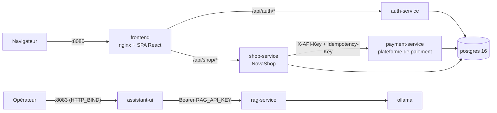
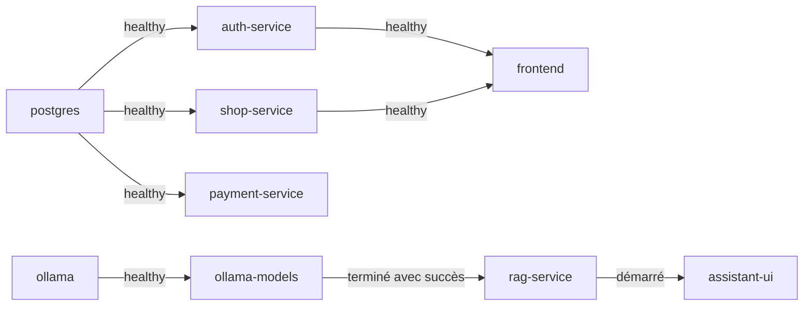

# Architecture générale de la plateforme

Description de la stack RESILIENCE-ALPHA telle qu'elle existe dans le dépôt au 20/10/2026 : la plateforme
de paiement fictive `payment-service`, la boutique marchande NovaShop et l'assistant documentaire des
opérateurs. Sources : `docker-compose.yml`, `services/*/app/`, `frontend/`.

## Vue d'ensemble

Le projet Docker Compose s'appelle `novashop`. Il regroupe trois ensembles :

- **La plateforme de paiement** (`payment-service`) : le système critique. Elle encaisse les paiements par
  carte pour le compte de marchands, rembourse, et journalise chaque changement d'état. C'est elle qui est
  attaquée, surveillée et rétablie. La preuve de reprise est une nouvelle transaction au statut `CAPTURED`.
- **Le marchand NovaShop** : `frontend` (nginx + React), `auth-service` (comptes clients) et `shop-service`
  (catalogue, panier, commandes). Il produit des transactions réelles de bout en bout.
- **L'assistant des opérateurs** (profil `ai`) : `ollama`, `ollama-models`, `rag-service`, `assistant-ui`.

`postgres` héberge les bases des trois services métier. `adminer` et `payment-console` (profil `tools`) sont
des outils d'exploration optionnels.

## Schéma des composants

Lecture du schéma : le navigateur ne parle qu'à `frontend`. `frontend` relaie vers `auth-service` et
`shop-service`. Seul `shop-service` appelle `payment-service`. Chaque service métier a sa propre base dans
`postgres`. L'assistant est un ensemble séparé, sans aucun lien réseau avec la plateforme.

## Rôle de chaque service

### frontend

Conteneur nginx 1.27 (alpine) qui sert la SPA React 18 / Tailwind 3 (construite avec Vite) et fait office de
**passerelle API** : `/api/auth/*` vers `auth-service`, `/api/shop/*` vers `shop-service`. C'est le seul
service métier publié sur l'hôte (`${HTTP_BIND}:${HTTP_PORT}`, port 8080 par défaut). `payment-service`
n'y est volontairement pas routé. Pas de healthcheck défini. Configuration : `frontend/nginx.conf`.

### auth-service

API FastAPI (Python 3.12), préfixe `/api/auth`, port interne 8000. Gère les comptes clients de NovaShop :
inscription, connexion, profil. Hache les mots de passe avec bcrypt (12 tours) et signe des jetons JWT HS256
valables 60 minutes. Base `auth_db`, rôle `auth_user`. Crée au démarrage les comptes de démonstration
`leo@novashop.fr` et `ines@novashop.fr` (désactivable : `SEED_DEMO_USERS=false`).

### shop-service

API FastAPI, préfixe `/api/shop`, port interne 8000. C'est le marchand NovaShop : catalogue (5 catégories,
21 produits), panier, commandes, visuels SVG générés à la volée. Vérifie les JWT localement, sans appeler
`auth-service`. Délègue le débit et le remboursement des cartes à `payment-service`. Base `shop_db`,
rôle `shop_user`. Seul service connecté à la fois au réseau du front et au réseau du paiement.

### payment-service

API FastAPI, préfixe `/api/payment`, port interne 8000. Plateforme de paiement : transactions par carte,
remboursements, journal `transaction_events`. Authentifie les marchands par clé API (en-tête `X-API-Key`,
seul le hash SHA-256 est stocké). Paiements idempotents (en-tête `Idempotency-Key`). Base `payment_db`,
rôle `payment_user`. Non publié : joignable uniquement par `shop-service` et par `payment-console`.
Pas de CORS : jamais appelé par un navigateur.

### postgres

PostgreSQL 16 (alpine). Une seule instance, trois bases (`auth_db`, `shop_db`, `payment_db`) et un rôle par
service, créés par `db/init/01-init-databases.sh` à la création du volume `pgdata`. Branché sur les réseaux
`backend` et `payment-db`. Non publié sur l'hôte.

### Outils du profil tools : adminer et payment-console

- `adminer` (image `adminer:4`) : interface web Postgres, publiée sur `127.0.0.1:8081` uniquement.
- `payment-console` (nginx 1.27) : proxy qui donne accès au Swagger de `payment-service` sur
  `127.0.0.1:8082`, sans publier `payment-service` lui-même. Configuration : `tools/payment-console.conf`.

Lancement : `docker compose --profile tools up -d`.

### Assistant du profil ai : ollama, ollama-models, rag-service, assistant-ui

- `ollama` (0.35.1) : sert les modèles locaux `gemma4:e4b` (génération) et `embeddinggemma` (vectorisation).
  Non publié. Une requête à la fois (`OLLAMA_NUM_PARALLEL=1`).
- `ollama-models` : conteneur ponctuel qui télécharge les modèles absents puis s'arrête.
- `rag-service` : API FastAPI + LangChain, préfixe `/api/rag`. Indexe `documents/` et le README dans Chroma,
  répond aux questions en citant ses sources, lit les fichiers joints dans le chat. API compatible OpenAI.
- `assistant-ui` (Streamlit 1.65) : interface de chat (une conversation, des fichiers joints), publiée
  comme le site, sur `HTTP_BIND:8083`. Sans compte ni historique enregistré : rien n'est écrit sur disque.

L'assistant explique, il n'agit pas : aucun accès au socket Docker ni aux réseaux de la plateforme.

## Technologies et versions

| Composant | Technologie | Version |
|-----------|-------------|---------|
| Services Python | `python:3.12-slim`, FastAPI, uvicorn | 0.115.6, 0.32.1 |
| Accès base | SQLAlchemy, psycopg | 2.0.36, 3.2.3 |
| Auth | bcrypt, PyJWT | 4.2.1, 2.10.1 |
| Client HTTP de shop-service | httpx | 0.28.1 |
| Front | React 18, Tailwind 3, Vite, build `node:20-alpine` | – |
| Passerelle | `nginx:1.27-alpine` | 1.27 |
| Base | `postgres:16-alpine` | 16 |
| RAG | langchain-core, langchain-ollama, langchain-chroma, chromadb, rank-bm25 | 1.6.6, 1.1.0, 1.1.0, 1.5.9, 0.2.2 |
| Modèles | `ollama/ollama`, `gemma4:e4b`, `embeddinggemma` | 0.35.1 |
| Chat | Streamlit (`services/assistant-ui`) | 1.65.0 |

## Profils Docker Compose

| Profil | Services | Commande |
|--------|----------|----------|
| (aucun) | `postgres`, `auth-service`, `shop-service`, `payment-service`, `frontend` | `docker compose up -d --build` |
| `tools` | `adminer`, `payment-console` | `docker compose --profile tools up -d` |
| `ai` | `ollama`, `ollama-models`, `rag-service`, `assistant-ui` | `docker compose --profile ai up -d` |

Avec une carte NVIDIA, ajouter `-f docker-compose.yml -f docker-compose.gpu.yml` (fichier qui donne
`gpus: all` à `ollama`).

## Volumes et fichiers montés

| Volume ou montage | Service | Contenu |
|-------------------|---------|---------|
| `pgdata` | postgres | Données des trois bases |
| `./db/init` (lecture seule) | postgres | Script de création des bases et rôles |
| `ollama-models` | ollama | Modèles téléchargés (environ 7 Go) |
| `rag-index` | rag-service | Index Chroma des documents |
| `./documents` (lecture seule) | rag-service | Documents lus par l'assistant |
| `./README.md` (lecture seule) | rag-service | Indexé sous le nom `project/README.md` |
| `./tools/payment-console.conf` (lecture seule) | payment-console | Configuration du proxy |

## Ordre de démarrage

- `auth-service`, `shop-service` et `payment-service` attendent que `postgres` soit `healthy`.
- `frontend` attend que `auth-service` et `shop-service` soient `healthy`.
- `rag-service` attend que `ollama-models` ait fini de télécharger les modèles.

### Pourquoi shop-service ne dépend pas de payment-service

Choix volontaire (commentaire dans `docker-compose.yml`) : si `payment-service` tombe, la boutique reste
consultable (catalogue, panier) et le paiement répond 503 sans rien débiter. C'est le **mode dégradé** de
NovaShop. Si `shop-service` dépendait de `payment-service`, une panne du paiement empêcherait aussi le
démarrage de la boutique.

## Sondes de santé (healthchecks)

| Service | Commande de la sonde | Intervalle | Délai | Essais | Démarrage |
|---------|----------------------|------------|-------|--------|-----------|
| `postgres` | `pg_isready -h 127.0.0.1 -U postgres -d shop_db` | 5 s | 3 s | 20 | – |
| `auth-service` | GET `http://127.0.0.1:8000/api/auth/health` | 10 s | 3 s | 5 | 15 s |
| `shop-service` | GET `http://127.0.0.1:8000/api/shop/health` | 10 s | 3 s | 5 | 15 s |
| `payment-service` | GET `http://127.0.0.1:8000/api/payment/health` | 10 s | 3 s | 5 | 15 s |
| `rag-service` | GET `http://127.0.0.1:8000/api/rag/health` | 10 s | 3 s | 5 | 20 s |
| `ollama` | `ollama list` | 10 s | 5 s | 10 | – |

Les sondes des services Python sont définies dans leur `Dockerfile` (instruction `HEALTHCHECK`). Elles ne
vérifient que la vivacité du processus : la route `/health` répond `{"status": "ok"}` **sans interroger la
base**. Un service peut donc être `healthy` alors que sa base est injoignable. Voir
`metriques-journaux-et-signaux.md`.

`frontend`, `adminer` et `payment-console` n'ont pas de healthcheck dans `docker-compose.yml`.

## Redémarrage automatique

- `restart: unless-stopped` : `postgres`, `auth-service`, `shop-service`, `payment-service`, `frontend`,
  `ollama`, `rag-service`, `assistant-ui`. Docker relance le conteneur si son processus s'arrête.
- `restart: "no"` : `ollama-models` (tâche ponctuelle).
- Pas de politique : `adminer`, `payment-console`.

Attention : Docker Compose ne redémarre **pas** un conteneur passé `unhealthy`. Le statut de santé est
seulement un indicateur, et il conditionne les `depends_on` au démarrage. Relancer un conteneur `unhealthy`
reste à la charge du moteur de remédiation.

## Initialisation des services Python au démarrage

`auth-service`, `shop-service` et `payment-service` exécutent `init_db()` au démarrage :

1. création des tables (`Base.metadata.create_all`, pas de migrations Alembic) ;
2. si Postgres ne répond pas : 15 tentatives espacées de 2 s (log `Base indisponible (tentative 3/15), nouvel
   essai dans 2.0s`), puis arrêt du processus (`RuntimeError`), et Docker relance le conteneur ;
3. données de démonstration, si absentes :
   - `auth-service` : comptes de démo (log `Comptes de démo créés : leo@novashop.fr, ines@novashop.fr`) ;
   - `shop-service` : catalogue (log `Catalogue de démonstration inséré : 21 produits`) ;
   - `payment-service` : marchand `novashop` (log `Marchand de démo novashop : créé`, ou `clé API renouvelée`
     si `MERCHANT_API_KEY` a changé).

`rag-service` démarre son cycle d'indexation et précharge le modèle (log `Modèle gemma4:e4b chargé`).
