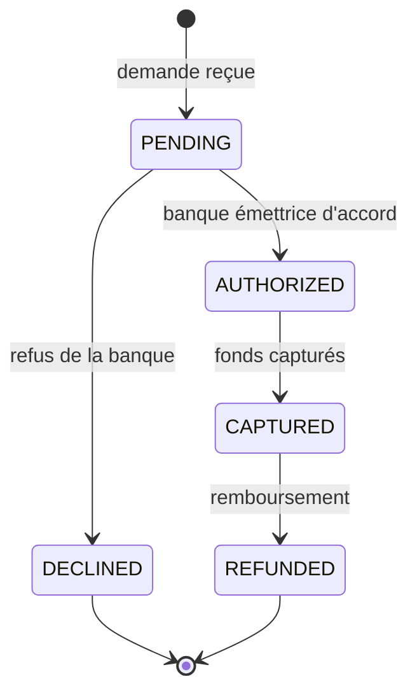

# Cycle de vie d'une transaction de paiement

États d'une transaction dans `payment-service`, transitions autorisées, journal des événements et règles
d'idempotence. Code : `services/payment-service/app/models.py` (`_TRANSITIONS`, `Transaction.record`),
`transaction_service.py`, `processor.py`.

## Diagramme d'états

## États d'une transaction

| État | Signification |
|------|---------------|
| `PENDING` | Demande reçue, en cours de traitement |
| `AUTHORIZED` | Acceptée par la banque émettrice fictive |
| `CAPTURED` | Fonds prélevés : paiement terminé |
| `DECLINED` | Refusée par la banque émettrice (état final) |
| `REFUNDED` | Remboursée intégralement (état final) |

## Transitions autorisées

Seules ces transitions sont permises : `PENDING → AUTHORIZED`, `PENDING → DECLINED`,
`AUTHORIZED → CAPTURED`, `CAPTURED → REFUNDED`. Toute autre transition lève l'erreur
`Transition interdite : <ancien> → <nouveau>` : c'est un bug, jamais une donnée enregistrée.

`DECLINED` et `REFUNDED` sont des états finaux : une transaction refusée ne peut pas être remboursée (409),
une transaction remboursée ne change plus.

## États réellement visibles en base

L'autorisation et la capture se font en une seule étape, dans une seule transaction SQL. La colonne
`transactions.status` ne contient donc jamais que trois valeurs : `CAPTURED`, `DECLINED` ou `REFUNDED`.
`PENDING` et `AUTHORIZED` n'apparaissent que dans le journal `transaction_events`. Un filtre
`?status=PENDING` sur `GET /api/payment/transactions` renvoie toujours une liste vide.

## Journal des événements (transaction_events)

Chaque changement d'état ajoute une ligne à `transaction_events` (ajout seul, jamais modifiée ni effacée),
avec l'horodatage et un message :

| Événement | Message enregistré |
|-----------|--------------------|
| `PENDING` | `Demande reçue de PokéBling` |
| `AUTHORIZED` | `Autorisée par la banque émettrice` |
| `CAPTURED` | `Fonds capturés` |
| `DECLINED` | Motif du refus, par exemple `Paiement refusé : fonds insuffisants` |
| `REFUNDED` | `Remboursement demandé par PokéBling` |

Un paiement accepté produit 3 événements (`PENDING`, `AUTHORIZED`, `CAPTURED`), un refus en produit 2
(`PENDING`, `DECLINED`), un remboursement en ajoute 1. Ce journal est la base de la traçabilité des
opérations et il est renvoyé dans le champ `events` de chaque transaction.

## Décision de la banque émettrice fictive

`processor.authorize()` simule le réseau carte, dans cet ordre :

1. date d'expiration passée : refus `expired_card` ;
2. numéro `4000000000000002` : refus `card_declined` ;
3. numéro `4000000000009995` : refus `insufficient_funds` ;
4. sinon : accord.

Marque de la carte (`card_brand`), d'après le début du numéro : `4` → `visa` ; `34` ou `37` → `amex` ;
`51` à `55` ou `2221` à `2720` → `mastercard` ; sinon `other`. Seuls la marque et les 4 derniers chiffres
sont stockés.

## Idempotence des paiements

Le marchand envoie une `Idempotency-Key` (PokéBling : le numéro de commande). Une contrainte unique
`(merchant_id, idempotency_key)` garantit au plus un paiement par clé et par marchand.

| Cas | Résultat |
|-----|----------|
| Clé jamais vue | Paiement traité normalement (201 ou 402) |
| Clé déjà vue, même montant, devise et `merchant_reference` | Transaction d'origine renvoyée, rien n'est redébité (200, ou 402 si elle avait été refusée), en-tête `Idempotent-Replayed: true` |
| Clé déjà vue, demande différente | 409 `Cette clé d'idempotence a déjà servi pour un autre paiement` |
| Deux requêtes simultanées avec la même clé | La seconde se heurte à la contrainte unique, récupère la transaction enregistrée par la première et la renvoie |
| Pas de clé | Chaque requête crée un nouveau paiement |

Cela rend sûres les nouvelles tentatives de `shop-service` après un délai dépassé : si la première requête
avait abouti sans que la réponse arrive, la seconde renvoie le même paiement.

## Identifiants d'une transaction

- `reference` : identifiant public, `PAY_` suivi de 16 caractères hexadécimaux en majuscules
  (par exemple `PAY_8FA8A393135D82FF`). Utilisé dans les URL et stocké par PokéBling dans
  `orders.payment_reference`.
- `merchant_reference` : référence côté marchand, le numéro de commande PokéBling (`CMD-AAMMJJ-XXXXXX`).
- `id` : UUID interne, jamais exposé par l'API.

## Horodatages d'une transaction

`created_at` (création, indexé), `updated_at` (dernière modification), `captured_at` (passage en
`CAPTURED`), `refunded_at` (passage en `REFUNDED`). Tous en UTC. Chaque événement du journal a aussi son
propre `created_at`.
