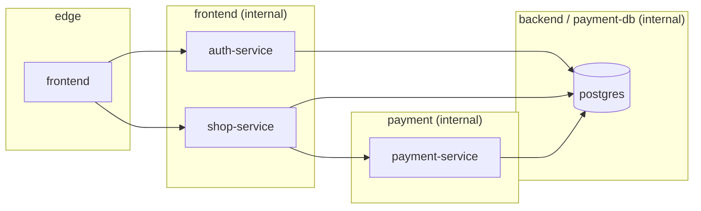

# Liens entre les services et réseaux Docker

Qui appelle qui, par quel réseau, avec quelle authentification, et ce qui n'est pas joignable. État au
21/10/2026, d'après `docker-compose.yml`, `frontend/nginx.conf`, `tools/payment-console.conf`,
`monitoring/metrics-gateway.conf.template` et le code des services.

## Matrice des flux

| Source | Destination | Chemin ou port | Authentification | Réseau |
|--------|-------------|----------------|------------------|--------|
| Navigateur | `frontend` | `HTTP_BIND:8080` | – | `edge` |
| `frontend` | `auth-service:8000` | `/api/auth/*` | JWT du client relayé | `frontend` |
| `frontend` | `shop-service:8000` | `/api/shop/*` | JWT du client relayé | `frontend` |
| `shop-service` | `payment-service:8000` | `/api/payment/transactions…` | `X-API-Key` marchand | `payment` |
| `auth-service` | `postgres:5432` | base `auth_db` | rôle `auth_user` | `backend` |
| `shop-service` | `postgres:5432` | base `shop_db` | rôle `shop_user` | `backend` |
| `payment-service` | `postgres:5432` | base `payment_db` | rôle `payment_user` | `payment-db` |
| `payment-console` | `payment-service:8000` | `/api/payment/*` | clé saisie par l'opérateur | `payment` |
| `adminer` | `postgres:5432` | toutes les bases | identifiants saisis | `backend` |
| `assistant-ui` | `rag-service:8000` | `/api/rag/v1/*` | `Bearer RAG_API_KEY` | `ai` |
| `rag-service` | `ollama:11434` | `/api/embed`, `/api/chat` | – | `ai` |
| `ollama-models` | `ollama:11434` | `show`, `pull` | – | `ai` |
| `ollama` | Internet | registre des modèles | – | `ai-egress` |
| Opérateur | `assistant-ui` | `HTTP_BIND:8083` | sans compte | `assistant-edge` |
| Prometheus (VM de supervision) | `metrics-gateway` | `METRICS_BIND:9464`, `/metrics/*` | `Bearer METRICS_TOKEN` | `monitoring-edge` |
| `metrics-gateway` | `auth-service`, `shop-service`, `payment-service`, `rag-service` | `:8000/metrics` | – (jeton déjà vérifié par la passerelle) | `frontend`, `payment`, `ai` |
| `metrics-gateway` | `nginx-exporter:9113` | `/metrics` | – | `frontend` |
| `nginx-exporter` | `frontend:8081` | `/stub_status` | – | `frontend` |
| `log-shipper` | `docker-socket-proxy:2375` | API Docker, lecture seule | – | `docker-api` |
| `log-shipper` | Loki (VM de supervision) | `LOKI_URL`, port 3100 | – | `monitoring-edge` |

## Schéma des flux réseau

`shop-service` est le seul service présent à la fois sur `frontend`, `payment` et `backend` : c'est le pont
obligatoire entre la boutique et la plateforme de paiement.

## Réseaux Docker

| Réseau | `internal` | Membres | Rôle |
|--------|------------|---------|------|
| `edge` | non | frontend | Porte le port publié 8080 |
| `frontend` | oui | frontend, auth-service, shop-service, metrics-gateway, nginx-exporter | nginx vers les API ; collecte des métriques |
| `payment` | oui | shop-service, payment-service, payment-console, metrics-gateway | Appels de paiement ; collecte des métriques |
| `backend` | oui | auth-service, shop-service, postgres, adminer | Accès aux bases boutique |
| `payment-db` | oui | payment-service, postgres | Accès à `payment_db` |
| `tools` | non | adminer, payment-console | Ports des outils (profil `tools`) |
| `ai` | oui | ollama, ollama-models, rag-service, assistant-ui, metrics-gateway | Assistant (profil `ai`) ; collecte des métriques |
| `ai-egress` | non | ollama | Téléchargement des modèles |
| `assistant-edge` | non | assistant-ui | Porte le port publié 8083 |
| `monitoring-edge` | non | metrics-gateway, log-shipper | Port publié 9464 ; envoi des journaux à la VM (profil `monitoring`) |
| `docker-api` | oui | log-shipper, docker-socket-proxy | Lecture de l'API Docker (profil `monitoring`) |

Un réseau `internal` n'a pas de route vers l'extérieur de Docker. Les API et la base ne peuvent donc rien
envoyer hors de l'hôte (protection contre l'exfiltration). Les seuls conteneurs qui ont une route sortante
sont ceux branchés sur un réseau non `internal` : `frontend`, `ollama`, `assistant-ui`, `adminer`,
`payment-console`, `metrics-gateway` et `log-shipper`.

`metrics-gateway` rejoint les réseaux existants (comme `payment-console`) plutôt qu'un réseau de supervision
commun : sur un réseau commun, chaque service pourrait joindre tous les autres (`auth-service` vers
`payment-service`…). Les conteneurs de `frontend`, `payment` et `ai` peuvent appeler la passerelle, mais elle ne
relaie que les routes `/metrics` et exige le jeton.

## Ce qui n'est pas joignable

- **Depuis le réseau (Wi-Fi, point d'accès)** : seuls le port 8080 de `frontend`, le port 8083
  d'`assistant-ui` (profil `ai`) et le port 9464 de `metrics-gateway` (profil `monitoring`, jeton exigé)
  répondent. Les ports 8081 et 8082 sont liés à `127.0.0.1` : visibles uniquement depuis le PC Hôte.
- **`payment-service`** n'est joignable que par `shop-service` et `payment-console`, et par `metrics-gateway`
  pour sa seule route `/metrics`. Ni `frontend` (nginx) ni `auth-service` ne le voient.
- **Les routes `/metrics`** ne sont pas relayées par la passerelle du site : `http://<hôte>:8080/metrics`
  renvoie la page de la SPA. Le port 8081 du frontend (`stub_status`) n'est pas publié.
- **Par la passerelle**, `/api/payment/*` n'est pas routé : un GET renvoie la page HTML de la SPA (code 200,
  `text/html`), un POST renvoie `405 Not Allowed`. Même chose pour `/api/rag/*`.
- **`postgres`** n'est joignable ni par `frontend` ni par le réseau.
- **`rag-service`** n'a aucun accès aux réseaux de la plateforme : il ne peut ni lire les bases ni appeler les
  API. Il ne voit que `ollama`, `assistant-ui` et, avec le profil `monitoring`, `metrics-gateway` (sans le jeton,
  elle lui répond 401).
- **`auth-service`** ne voit pas `payment-service`, et `payment-service` ne voit pas `auth-service`.

## Authentification entre services

### Navigateur vers auth-service et shop-service : JWT

`auth-service` signe un JWT HS256 à la connexion. Le navigateur le garde dans `localStorage`
(`novashop_token`) et l'envoie dans `Authorization: Bearer <jeton>`. nginx relaie l'en-tête tel quel.
`shop-service` vérifie le jeton **localement** avec le même secret `JWT_SECRET` : aucun appel réseau vers
`auth-service` par requête. Détails : `processus-authentification-jwt.md`.

### shop-service vers payment-service : clé API marchand

NovaShop est un marchand de la plateforme. `shop-service` envoie sa clé dans `X-API-Key` (variable
`PAYMENT_API_KEY`, alimentée par `MERCHANT_API_KEY`). `payment-service` en calcule le SHA-256 et cherche le
marchand correspondant dans `merchants.api_key_hash`. Chaque paiement porte aussi `Idempotency-Key` = numéro
de commande. `payment-service` ne connaît pas le secret JWT des clients NovaShop.

### assistant-ui vers rag-service : clé partagée

`assistant-ui` appelle l'API compatible OpenAI de `rag-service` avec `Authorization: Bearer <RAG_API_KEY>`.
`rag-service` compare la clé en temps constant (`secrets.compare_digest`). `assistant-ui` n'appelle que
`rag-service` : il n'a aucun accès direct à `ollama`.

### Services vers postgres : un rôle par base

Chaque service se connecte avec son propre rôle (`auth_user`, `shop_user`, `payment_user`), propriétaire de
sa seule base. Le script d'init fait `REVOKE ALL ON DATABASE … FROM PUBLIC` : un rôle ne peut pas se
connecter à la base d'un autre service.

## Ports publiés sur l'hôte

| Port | Service | Adresse d'écoute | Profil |
|------|---------|------------------|--------|
| 8080 | `frontend` | `HTTP_BIND` (défaut `0.0.0.0`, jour J `192.168.137.1`) | – |
| 8081 | `adminer` | `127.0.0.1` | `tools` |
| 8082 | `payment-console` | `127.0.0.1` | `tools` |
| 8083 | `assistant-ui` | `ASSISTANT_BIND` (défaut : la valeur de `HTTP_BIND`) | `ai` |
| 9464 | `metrics-gateway` | `METRICS_BIND` (défaut : la valeur de `HTTP_BIND`) ; port `METRICS_PORT` | `monitoring` |

Avec `HTTP_BIND=192.168.137.1`, le site n'est publié que sur le point d'accès du consortium, pas sur le
Wi-Fi du campus. Le point d'accès doit être actif avant `docker compose up`, et le site s'ouvre alors sur
`http://192.168.137.1:8080` (plus sur `localhost`). L'assistant suit : `http://192.168.137.1:8083`.

## Résolution DNS après recréation d'un conteneur

`frontend`, `payment-console` et `metrics-gateway` interrogent le DNS interne de Docker
(`resolver 127.0.0.11 valid=5s`) à chaque requête, via une variable dans `proxy_pass`. Quand un service est recréé (redéploiement,
remédiation), il change d'adresse IP : nginx suit le changement en 5 s au plus, sans redémarrage.
Avec un nom fixe dans `proxy_pass`, nginx garderait l'ancienne IP et répondrait 502 alors que le service
est sain. `shop-service` appelle `payment-service` par son nom DNS (`http://payment-service:8000`).

## Effet de la panne d'un service sur les autres

| Service indisponible | Effet observé |
|----------------------|---------------|
| `payment-service` | `POST /api/shop/orders` et l'annulation répondent 503 ; rien n'est débité. Catalogue, panier, connexion fonctionnent |
| `postgres` | Les trois API répondent 500 sur toute route qui lit leur base (catalogue, connexion, panier, paiement). Les sondes `/health` restent vertes, car elles n'interrogent pas la base |
| `auth-service` | nginx répond 502 sur `/api/auth/*`. Une session déjà ouverte continue à fonctionner côté boutique (JWT vérifié localement), mais un rechargement de page déconnecte l'utilisateur (`GET /api/auth/me` échoue) |
| `shop-service` | nginx répond 502 sur `/api/shop/*` : plus de catalogue, panier ni commande |
| `frontend` | Plus rien n'est accessible depuis le navigateur |
| `ollama` | L'assistant répond 503 `Recherche documentaire indisponible (Ollama injoignable ?)` ; l'indexation reprend au cycle suivant |
| `rag-service` | `assistant-ui` affiche « L'assistant est injoignable… » ; la plateforme n'est pas touchée |
| `metrics-gateway`, `nginx-exporter` | Prometheus ne reçoit plus les métriques concernées (`up` à 0) ; la plateforme n'est pas touchée |
| `log-shipper`, `docker-socket-proxy` | Loki ne reçoit plus de journaux ; au redémarrage, `log-shipper` reprend là où il s'était arrêté |
