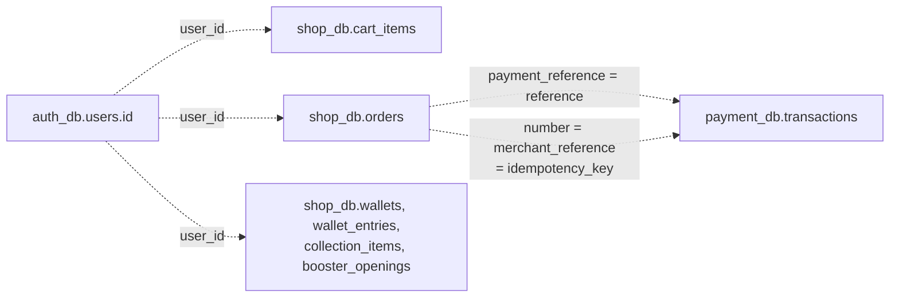
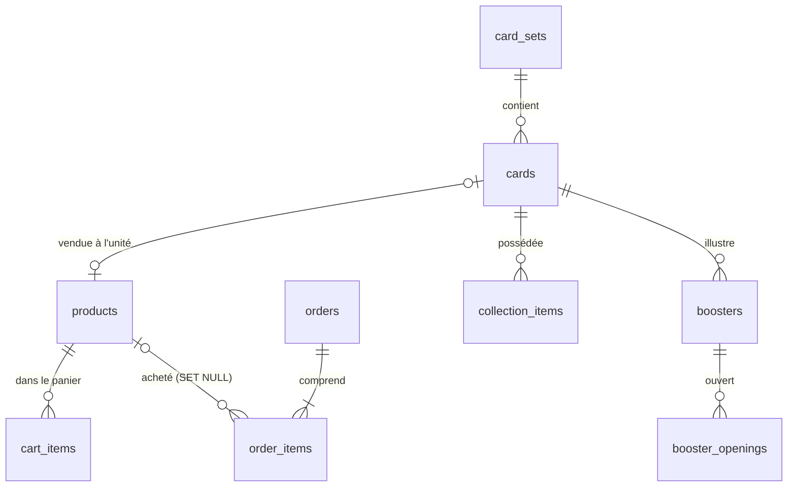
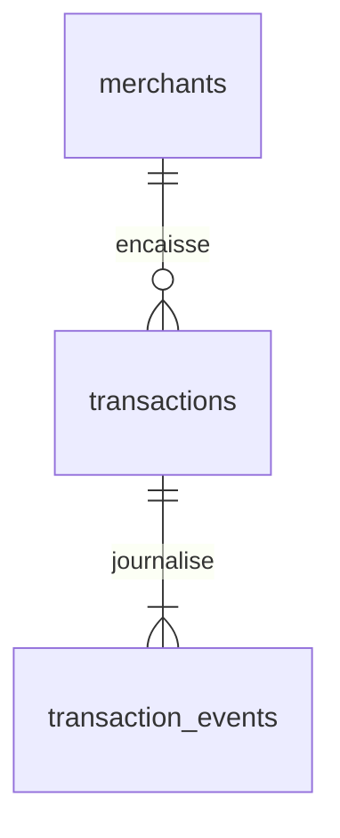

# Modèle de données

Tables des trois bases PostgreSQL (`auth_db`, `shop_db`, `payment_db`) et de l'index de l'assistant. Principe
**database-per-service** : chaque service n'accède qu'à sa base, avec son propre rôle. Pas de clé étrangère
entre services : les liens se font par identifiant. Les tables sont créées par `create_all` au démarrage
(pas de migrations). Code : `services/*/app/models.py`.

## Liens entre les bases

| Donnée dans shop_db | Référence | Donnée dans l'autre base |
|---------------------|-----------|--------------------------|
| `cart_items.user_id`, `orders.user_id`, `wallets.user_id`, `wallet_entries.user_id`, `collection_items.user_id`, `booster_openings.user_id` | UUID de l'utilisateur | `auth_db.users.id` |
| `orders.payment_reference` | `PAY_…` | `payment_db.transactions.reference` |
| `orders.number` | `CMD-…` | `payment_db.transactions.merchant_reference` et `idempotency_key` |

Ces liens ne sont garantis par aucune contrainte : leur cohérence se vérifie par rapprochement (voir
`metriques-journaux-et-signaux.md`).

## Base auth_db (auth-service)

### Table users

| Colonne | Type | Contraintes |
|---------|------|-------------|
| `id` | UUID | Clé primaire |
| `email` | varchar(255) | Unique, indexé, en minuscules |
| `full_name` | varchar(100) | – |
| `hashed_password` | varchar(60) | Hash bcrypt (toujours 60 caractères) |
| `is_active` | boolean | Défaut `true` |
| `created_at` | timestamptz | Défaut `now()` |

## Base shop_db (shop-service)

Boutique PokéBling : cartes Pokémon numériques (données de référence issues de TCGdex), produits vendus en
euros, panier, commandes, porte-monnaie de PokéDollars, boosters et collection.

### Tables card_sets et cards (données de référence)

`card_sets` : `id` (identifiant TCGdex, clé primaire : `base1` à `base3`, `bw1` à `bw10`, `dv1`, `sv03.5`, `sv08.5`),
`name`, `serie` (`Base`, `Noir & Blanc`, `Écarlate et Violet`), `release_date`, `logo_url`, `position` (ordre
d'affichage : par série, puis par date de sortie).

| Colonne de cards | Type | Remarque |
|------------------|------|----------|
| `id` | varchar(30) | Clé primaire, identifiant TCGdex (`base1-4`) |
| `slug` | varchar(80) | Unique, identique au slug du produit qui vend la carte |
| `set_id` | varchar(20) | Clé étrangère vers `card_sets`, indexée |
| `number`, `name`, `category` | – | Numéro dans le set, nom français, Pokémon / Dresseur / Énergie |
| `rarity` | enum `card_rarity` | `COMMON` < `UNCOMMON` < `RARE` < `HOLO` < `ULTRA` < `SECRET` (Postgres trie dans cet ordre) |
| `rarity_label` | varchar(40) | Libellé d'origine (`Rare Holo`, `Rare EX`, `Magnifique rare`, `Illustration spéciale rare`…) |
| `types` | JSONB | Liste des types (`["Feu"]`), filtrée avec l'opérateur `@>` |
| `hp`, `illustrator`, `description` | – | Facultatifs |
| `image_url` | varchar(300) | Image chez TCGdex, sans extension (`/low.webp`, `/high.webp`) |

Insérées depuis `app/data/cards.json` (1 797 cartes) : toutes au premier démarrage, puis seulement celles des
sets ajoutés depuis. Une carte déjà en base n'est jamais modifiée (ni son prix, ni son stock). Aucune image n'est
stockée.

### Table products

| Colonne | Type | Remarque |
|---------|------|----------|
| `id` | entier | Clé primaire |
| `slug` | varchar(80) | Unique, indexé, utilisé dans les URL |
| `kind` | enum `product_kind` | `CARD` (carte à l'unité) ou `POKEDOLLARS` (lot de PokéDollars) |
| `name`, `description` | texte | – |
| `price` | numeric(10,2) | Contrainte `ck_product_price_positive` : > 0 |
| `compare_at_price` | numeric(10,2) | Prix barré, `null` si pas de promotion |
| `stock` | entier | `null` = illimité (PokéDollars) ; contrainte `ck_product_stock_non_negative` : ≥ 0 |
| `card_id` | varchar(30) | Clé étrangère vers `cards`, unique ; renseignée si et seulement si `kind = CARD` (`ck_product_card`) |
| `pokedollars` | entier | Montant crédité ; renseigné si et seulement si `kind = POKEDOLLARS`, > 0 |
| `is_featured`, `created_at` | – | Mise en avant |

La contrainte `stock >= 0` empêche en dernier recours toute survente, en plus des verrous posés au paiement.

### Table cart_items

Une ligne par article du panier d'un client connecté : `id`, `user_id` (UUID d'`auth-service`, indexé),
`product_id` (clé étrangère, `ON DELETE CASCADE`), `quantity` (contrainte > 0), `added_at`. Contrainte unique
`uq_cart_user_product` sur `(user_id, product_id)`.

### Table orders

| Colonne | Type | Remarque |
|---------|------|----------|
| `id` | UUID | Clé primaire, utilisée dans `/api/shop/orders/{id}` |
| `number` | varchar(20) | Unique, `CMD-AAMMJJ-XXXXXX` |
| `user_id`, `customer_email` | UUID, texte | Client, repris du JWT |
| `status` | enum `order_status` | `PAID` ou `CANCELLED` |
| `total` | numeric(10,2) | Calculé par `shop-service` (pas de frais de port : tout est numérique) |
| `pokedollars` | entier | PokéDollars crédités par la commande (0 si aucun) |
| `card_last4` | varchar(4) | Seule donnée de carte conservée |
| `payment_reference` | varchar(32) | Référence `PAY_…` chez `payment-service` |
| `created_at`, `cancelled_at` | timestamptz | `created_at` indexé |

### Table order_items

Lignes de commande, **figées au moment de l'achat** : `product_slug`, `product_name`, `kind`, `card_id`,
`pokedollars` (par unité), `image_url`, `unit_price`, `quantity` (> 0), `line_total`. `order_id` : clé
étrangère `ON DELETE CASCADE`. `product_id` : clé étrangère `ON DELETE SET NULL`, pour garder la commande si le
produit est supprimé. Un changement de prix au catalogue ne modifie donc pas les commandes passées.

### Tables wallets et wallet_entries (PokéDollars)

`wallets` : un porte-monnaie par utilisateur, créé à son premier mouvement : `user_id` (clé primaire),
`balance` (contrainte `ck_wallet_balance_non_negative` : ≥ 0), `updated_at`. Ligne verrouillée
(`SELECT … FOR UPDATE`) à chaque crédit ou débit.

`wallet_entries` : journal des mouvements, en ajout seul : `id`, `user_id` (indexé), `amount` (positif = crédit,
négatif = débit), `balance_after`, `reason` (enum `wallet_reason` : `PURCHASE`, `BOOSTER`, `REFUND`),
`reference` (numéro de commande ou identifiant d'ouverture), `label`, `created_at`. Le solde se justifie ligne
à ligne : `balance` = somme des `amount` de l'utilisateur.

### Tables boosters et booster_openings

`boosters` : `id`, `slug` (unique), `name`, `description`, `price` (en PokéDollars, > 0), `set_ids` (JSONB),
`slots` (JSONB : une entrée par carte, `{rareté: poids}`), `cover_card_id` (clé étrangère vers `cards`),
`colors`, `position`. Ces colonnes sont remises à jour depuis `seed.py` à chaque démarrage.

`booster_openings` : historique des ouvertures : `id` (UUID), `user_id` (indexé), `booster_id`, `price` (payé),
`request_id` (clé d'idempotence envoyée par le navigateur ; contrainte unique `uq_opening_user_request` sur
`(user_id, request_id)`), `card_ids` (JSONB, ordre de révélation), `new_card_ids`, `opened_at`.

### Table collection_items

Les cartes possédées : clé primaire `(user_id, card_id)`, `card_id` (clé étrangère vers `cards`), `quantity`
(contrainte `ck_collection_quantity_positive` : > 0), `first_obtained_at`, `last_obtained_at`. Alimentée par les
commandes (cartes à l'unité) et les boosters, en `INSERT … ON CONFLICT DO UPDATE` (quantité ajoutée). Une
annulation de commande retire les exemplaires achetés (la ligne est supprimée à 0).

## Base payment_db (payment-service)

### Table merchants

`id` (UUID), `code` (unique, `novashop`, gardé de l'ancien nom), `name` (`PokéBling`, mis à jour au démarrage), `api_key_hash` (SHA-256 en hexadécimal,
64 caractères, unique), `is_active`, `created_at`. La clé API elle-même n'est jamais stockée.

### Table transactions

| Colonne | Type | Remarque |
|---------|------|----------|
| `id` | UUID | Clé primaire interne |
| `reference` | varchar(32) | Unique, `PAY_` + 16 hexadécimaux |
| `merchant_id` | UUID | Clé étrangère vers `merchants`, indexée |
| `merchant_reference` | varchar(64) | Numéro de commande du marchand, indexé |
| `idempotency_key` | varchar(64) | Unique par marchand (`uq_transaction_idempotency`), facultatif |
| `amount` | numeric(12,2) | Contrainte `ck_transaction_amount_positive` : > 0 |
| `currency` | varchar(3) | `EUR` |
| `status` | enum `transaction_status` | En pratique `CAPTURED`, `DECLINED` ou `REFUNDED` |
| `card_brand`, `card_last4` | texte | Ni numéro complet ni CVC |
| `decline_code`, `decline_message` | texte | Renseignés si `DECLINED` |
| `created_at`, `updated_at`, `captured_at`, `refunded_at` | timestamptz | `created_at` indexé |

### Table transaction_events

Journal en ajout seul : `id` (entier croissant, ordre d'insertion), `transaction_id` (clé étrangère, indexée),
`status`, `message` (200 caractères), `created_at`. Aucune route ne modifie ni ne supprime une ligne de
cette table.

## Données de carte conservées

| Donnée | Navigateur | shop-service | payment-service |
|--------|------------|--------------|-----------------|
| Numéro complet | saisi | en mémoire le temps de l'appel | en mémoire le temps de la décision |
| CVC | saisi | en mémoire | en mémoire |
| Date d'expiration | saisie | en mémoire | en mémoire |
| 4 derniers chiffres | – | `orders.card_last4` | `transactions.card_last4` |
| Marque | – | – | `transactions.card_brand` |

## Index de l'assistant (volume rag-index)

Base Chroma persistée dans le volume `rag-index`, collection `docs-embeddinggemma-latest`. Chaque extrait
stocke son texte, son vecteur et les métadonnées `source` (ex. `documents/modele-de-donnees.md`),
`fingerprint` (empreinte du fichier), `section` (titres Markdown) ou `page` (PDF). Supprimer le volume force
une réindexation complète au démarrage suivant.

## Réinitialiser une base

- Tout effacer : `docker compose down -v` (supprime aussi `pgdata` ; catalogue, comptes de démo et marchand
  sont recréés au démarrage).
- Tables de `shop-service` seulement : voir la commande `DROP TABLE` du README, puis
  `docker compose restart shop-service`.
- Passage de NovaShop à PokéBling : au démarrage, `shop-service` reconnaît les tables de l'ancienne boutique
  (table `products` sans colonne `kind`), les supprime et journalise
  `Tables de l'ancienne boutique NovaShop détectées : suppression avant la création de PokéBling`. Les comptes
  (`auth_db`) et les transactions (`payment_db`) ne sont pas touchés.
- Après une modification des modèles, il faut recréer les tables : `create_all` n'ajoute pas les colonnes
  manquantes d'une table existante.
