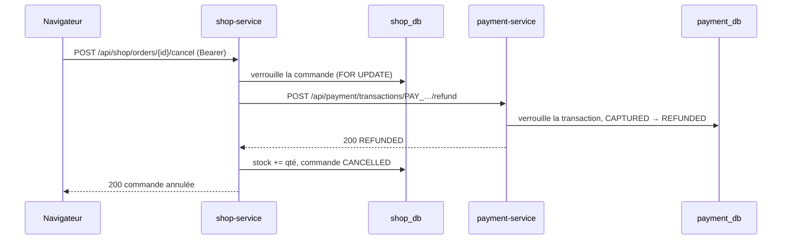

# Processus d'annulation et de remboursement

Ce qui se passe quand un client annule une commande payée : `shop-service` fait rembourser la transaction par
`payment-service`, remet les articles en stock et passe la commande en `CANCELLED`. Code :
`services/shop-service/app/order_service.py` (`cancel`), `services/payment-service/app/transaction_service.py`
(`refund`).

## Schéma de séquence de l'annulation

## Étapes de l'annulation

1. `shop-service` charge la commande du client et la verrouille. Commande d'un autre client ou inexistante :
   404 `Commande introuvable`.
2. Si elle n'est plus `PAID` : 409 `Cette commande est déjà annulée`.
3. **Remboursement d'abord** : appel de `POST /api/payment/transactions/{payment_reference}/refund`, avec les
   mêmes délais et nouvelles tentatives que le paiement (2 tentatives, 3 s chacune).
4. Remise en stock : les produits sont verrouillés (triés par id) et leur stock augmenté de la quantité
   commandée. Un produit supprimé du catalogue entre-temps est ignoré.
5. Commande passée en `CANCELLED`, `cancelled_at` renseigné, `COMMIT`.

## Pourquoi rembourser avant d'annuler

Si le remboursement échoue, la commande reste `PAID` et le client peut réessayer : il n'existe jamais de
commande annulée dont l'argent n'a pas été rendu.

Le cas inverse (remboursement fait, puis échec de l'enregistrement de l'annulation) est sans danger : la
commande reste `PAID`, et une nouvelle annulation rappelle `refund`, qui répond 200 sans rien refaire puisque
la transaction est déjà `REFUNDED`. L'annulation se termine alors normalement.

## Issues possibles de l'annulation

| Situation | Réponse au client | Commande | Transaction |
|-----------|-------------------|----------|-------------|
| Remboursement accepté | 200 | `CANCELLED`, stock restitué | `REFUNDED` |
| Déjà remboursée côté plateforme | 200 | `CANCELLED`, stock restitué | `REFUNDED` (inchangée) |
| `payment-service` injoignable ou 5xx, 2 fois | 503 | reste `PAID` | inchangée |
| Remboursement refusé (409 transaction non capturée, 404, 401…) | 502 `Le remboursement n'a pas pu être effectué` | reste `PAID` | inchangée |
| Commande déjà annulée | 409 | inchangée | inchangée |

## Remboursement côté payment-service

`POST /api/payment/transactions/{reference}/refund` :

1. authentifie le marchand par `X-API-Key` ;
2. verrouille la transaction (`SELECT … FOR UPDATE`) : deux remboursements simultanés sont traités l'un après
   l'autre ;
3. si elle est déjà `REFUNDED` : la renvoie telle quelle (200, idempotent, pas de nouvelle ligne de journal) ;
4. si elle n'est pas `CAPTURED` (par exemple `DECLINED`) : 409
   `Seule une transaction capturée peut être remboursée` ;
5. sinon : passage en `REFUNDED`, `refunded_at` renseigné, événement
   `Remboursement demandé par NovaShop`, `COMMIT`, puis journal
   `transaction reference=PAY_… … status=REFUNDED …`.

Le remboursement est toujours intégral : il n'existe pas de remboursement partiel.

## Traces d'une annulation réussie

- nginx (`frontend`) : `"POST /api/shop/orders/<uuid>/cancel HTTP/1.1" 200` ;
- `payment-service`, journal uvicorn : `"POST /api/payment/transactions/PAY_…/refund HTTP/1.1" 200 OK` ;
- `payment-service`, journal métier : `transaction reference=PAY_… merchant=novashop merchant_reference=CMD-… status=REFUNDED …` ;
- `shop_db.orders` : `status = CANCELLED` ; `payment_db.transaction_events` : un événement `REFUNDED`.

En cas d'échec, `shop-service` journalise `Remboursement de PAY_… rejeté : <code> <corps>` (refus) ou
`payment-service injoignable (tentative N/2) : …` (panne).
