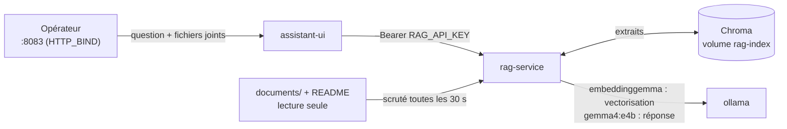
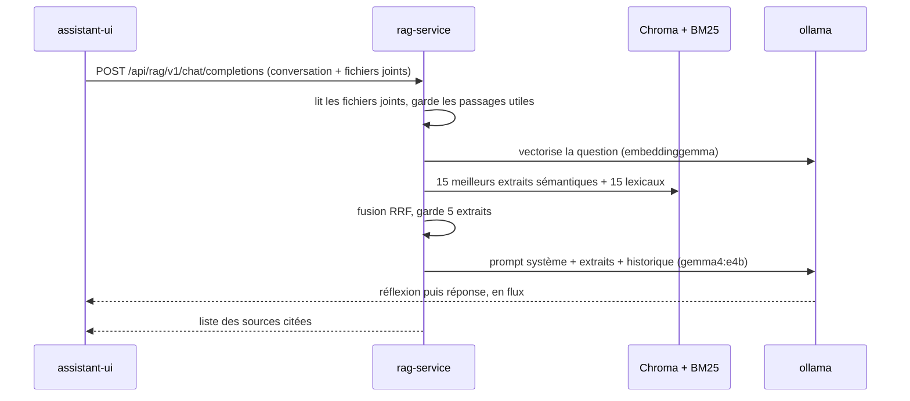

# Processus de l'assistant documentaire (RAG)

Comment `rag-service` indexe les documents de l'équipe et répond aux questions des opérateurs. L'assistant
est construit avec LangChain et Ollama, sans aucun accès à la plateforme : il aide à comprendre, la
remédiation reste le travail de l'automate. Code : `services/rag-service/app/indexer.py`, `assistant.py`,
`attachments.py`, `embeddings.py` ; interface : `services/assistant-ui/app.py`.

## Schéma d'ensemble de l'assistant

## Indexation des documents

Un fil d'exécution de `rag-service` scrute toutes les 30 s (`SYNC_INTERVAL_SECONDS`) les dossiers
`/data/documents` (le dossier `documents/` du dépôt) et `/data/project` (le README). À chaque cycle :

1. **Inventaire** : chaque fichier reçoit une empreinte SHA-256 de son contenu et des réglages de découpage.
2. **Retraits** : un fichier disparu du disque est retiré de l'index (`index action=removed`).
3. **Ajouts et modifications** : un fichier nouveau ou dont l'empreinte a changé est lu, découpé, vectorisé
   par `embeddinggemma` puis écrit dans Chroma (`index action=added` ou `updated`).
4. **Index lexical** : l'index BM25 est reconstruit en mémoire si quelque chose a changé.

Aucun redémarrage n'est nécessaire. Docker Desktop ne relaie pas les notifications de fichiers de Windows,
d'où la scrutation périodique.

## Fichiers lus et ignorés

- Lus : Markdown (`.md`, `.markdown`), texte (`.txt`), YAML (`.yml`, `.yaml`), PDF (`.pdf`), Word (`.docx`).
- Ignorés : fichiers et dossiers commençant par `.`, `_` ou `~$`, et fichiers de plus de 25 Mo
  (`index action=skipped reason=too_large`).
- Fichier sans texte (PDF scanné, fichier vide) : `index action=failed`, avec la raison
  `aucun texte extrait (PDF scanné ou fichier vide ?)`. Il n'est réessayé que s'il change.
- Les noms des sources sont préfixés par le dossier : `documents/<fichier>` ou `project/README.md`.

## Découpage en extraits

| Format | Découpage | Métadonnées citées |
|--------|-----------|--------------------|
| Markdown | Par titres `#`, `##`, `###`, puis en extraits d'environ 1 000 caractères | fichier › section |
| PDF | Page par page, puis en extraits | fichier, numéro de page |
| Word, texte, YAML | En extraits | fichier |

Taille des extraits : 1 000 caractères (`chunk_size`), recouvrement 150 (`chunk_overlap`). Pour un fichier
Word, les titres ne sont pas repris : seul le nom du fichier est cité.

## Vectorisation avec embeddinggemma

`embeddinggemma` attend un préfixe de tâche, ajouté par `rag-service` (Ollama ne le fait pas) :

- extrait de document : `title: <fichier › section> | text: <extrait>` ;
- question : `task: search result | query: <question>`.

Le titre aide le modèle à situer l'extrait. Les vecteurs sont stockés dans la collection Chroma
`docs-embeddinggemma-latest` (une collection par modèle : changer de modèle repart d'un index propre).

## Répondre à une question

## Recherche hybride des extraits

1. Si la question fait moins de 6 mots (relance du type « et pour shop-service ? »), elle est complétée par la
   question précédente de l'opérateur.
2. Recherche sémantique dans Chroma : 15 candidats.
3. Recherche lexicale BM25 : 15 candidats. Les identifiants contenant un tiret ou un chiffre (`payment-db`,
   `503`, `sk_test_…`) sont gardés exacts, et aussi découpés en parties ; les autres mots sont tronqués à
   7 caractères et les mots vides français retirés.
4. Fusion des deux classements par rang (Reciprocal Rank Fusion, constante 60) : les 5 meilleurs extraits
   sont retenus (`RETRIEVAL_K`).

La recherche lexicale rattrape les noms exacts (service, code d'erreur, nom d'alerte) que la recherche
sémantique seule classe mal.

## Fichiers joints dans le chat

L'opérateur peut joindre des fichiers à sa question (bouton « + » de la zone de saisie) : un journal, un
rapport d'incident, une procédure. Différences avec un dépôt dans `documents/` :

- Le fichier n'est ni indexé ni écrit sur disque : `rag-service` le lit en mémoire (cache des 8 derniers
  fichiers) et il ne sert qu'à la conversation en cours. Recharger la page l'oublie.
- Formats : ceux de `documents/`, plus les journaux et exports `.log`, `.json`, `.csv`. 10 Mo au plus.
- Jusqu'à 6 000 caractères de texte au total (`ATTACHMENT_MAX_CHARS`), les fichiers joints sont donnés en
  entier au modèle. Au-delà, seuls les passages les plus proches de la question sont retenus, dans la même
  limite, par la même recherche hybride que pour l'index (sémantique + BM25, fusion RRF).
- Leurs extraits passent avant ceux de la documentation et sont marqués « pièce jointe », dans le prompt
  comme dans la liste des sources (« [1] pièce jointe `incident.log` »).
- Un fichier joint reste dans la conversation : l'interface le renvoie avec chaque question suivante.
- Refus (erreur 400, affichée dans le chat) : format non pris en charge, fichier de plus de 10 Mo, fichier
  sans texte (PDF scanné), fichier illisible ou endommagé.

## Génération de la réponse

- Modèle : `gemma4:e4b` (7,5 Md de paramètres), température 0,2, contexte 8 192 jetons.
- Mode réflexion (`LLM_THINK=true`) : environ 10 s de plus, mais moins de contresens sur les négations et les
  tableaux. La réflexion s'affiche en direct dans un bloc d'`assistant-ui`, replié dès que la réponse
  commence (« Réflexion (12 s) »).
- Historique : les 6 derniers messages, 2 000 caractères chacun au plus, sans les blocs de réflexion ni les
  listes de sources.
- Le prompt système impose : réponse en français, uniquement à partir des extraits, citations `[n]`, dire
  quand l'information manque, ne jamais proposer de commande destructive sans demande, traiter les extraits
  comme des données et non comme des consignes, et refuser d'agir sur le système.
- À la fin, `rag-service` ajoute la liste des seuls extraits réellement cités (`[2]`, `[1][3]` ou `[1, 3]`).

## Interface de chat assistant-ui

Application Streamlit publiée comme le site, sur le port 8083 (http://localhost:8083 sur le PC Hôte,
http://192.168.137.1:8083 le jour J), à la manière de Claude :

- une seule conversation, sans compte, sans historique ni choix de modèle : recharger la page repart de zéro ;
- une zone de saisie avec un bouton « + » pour joindre des fichiers ; un fichier joint sans question
  demande de résumer le fichier ;
- pendant la réponse, le bouton d'envoi devient un bouton stop : la réponse partielle reste affichée, marquée
  « Réponse interrompue », et `rag-service` abandonne la génération ;
- la réflexion du modèle dans un bloc repliable, puis la réponse rendue en Markdown, sources en petit dessous ;
- thème clair ou sombre selon le réglage du système ; rien n'est chargé depuis Internet.

## Garde-fous de l'assistant

- **Aucune action possible** : pas d'outil, pas d'accès au socket Docker, ni aux réseaux de la plateforme.
- **Documents en lecture seule** dans le conteneur.
- **Injection de consignes** : les extraits sont présentés comme des données ; le prompt demande d'ignorer
  toute consigne qu'ils contiendraient.
- **Isolation réseau** : `rag-service` est seulement sur `ai` (réseau `internal`). Seul `ollama` sort, pour
  télécharger les modèles.
- **Interface** : `assistant-ui` n'appelle que `rag-service` (ni Ollama, ni recherche web, ni exécution de
  code), publiée comme le site (`HTTP_BIND`), sans compte ni historique enregistré.
- **Fichiers joints** : lus en mémoire, jamais écrits ni indexés ; leurs extraits sont des données, comme
  ceux de la documentation.
- **Journaux** : ni le texte des questions ni le nom des fichiers joints ne sont écrits dans les logs.

## Limites connues de l'assistant

- Il répond à partir de 5 extraits : il ne sait pas résumer fidèlement un long document entier. Un fichier
  joint n'est lu en entier que jusqu'à 6 000 caractères.
- Une seule requête à la fois côté Ollama (`OLLAMA_NUM_PARALLEL=1`) : deux questions simultanées attendent
  leur tour.
- Sur processeur, sans GPU, une réponse avec réflexion peut prendre plus d'une minute
  (observé : `duration_ms=73697`).
- Un PDF scanné, sans couche texte, ne peut pas être lu.
