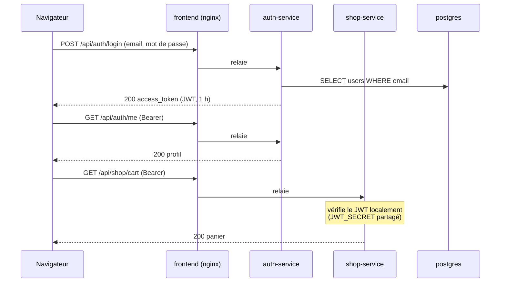

# Processus d'authentification des clients (JWT)

Comment un client PokéBling crée son compte, se connecte, et comment `shop-service` reconnaît ses requêtes
sans appeler `auth-service`. Code : `services/auth-service/app/security.py`,
`services/shop-service/app/security.py`, `frontend/src/context/AuthContext.jsx`.

## Schéma de la connexion

## Étapes de la connexion

1. Le navigateur envoie `POST /api/auth/login` (formulaire `username` = email, `password`).
2. `auth-service` cherche l'utilisateur, compare le mot de passe avec le hash bcrypt, et signe un JWT HS256.
3. Le front range le jeton dans `localStorage` (`pokebling_token`) et appelle `GET /api/auth/me` pour
   afficher le profil.
4. Juste après, si le visiteur avait un panier invité, le front appelle `POST /api/shop/cart/merge`.
5. Ensuite, chaque appel au panier ou aux commandes porte `Authorization: Bearer <jeton>`. `shop-service`
   vérifie le jeton lui-même : signature, émetteur, expiration.

## Contenu et vérification du JWT

Le jeton est signé en HS256 avec `JWT_SECRET`, partagé par `auth-service` (signature) et `shop-service`
(vérification). Revendications : `sub` (UUID de l'utilisateur), `email`, `name`, `iat`, `exp`,
`iss` = `novashop-auth`. Durée de vie : `JWT_EXPIRE_MINUTES` (60 par défaut).

| Contrôle | auth-service (`/me`) | shop-service (panier, commandes) |
|----------|----------------------|----------------------------------|
| Signature HS256 et `JWT_SECRET` | oui | oui |
| Émetteur `novashop-auth` | oui | oui |
| Expiration `exp` | oui | oui |
| Champs exigés | `sub`, `exp` | `sub`, `exp`, `email`, `name` |
| Compte encore existant et actif en base | oui | **non** |

Conséquence : un compte désactivé ou supprimé garde l'accès à la boutique jusqu'à l'expiration de son jeton
(au plus 60 minutes). Il n'existe ni révocation ni jeton de rafraîchissement.

## Inscription

1. `POST /api/auth/register` avec `email`, `full_name`, `password`.
2. Validation : email valide mis en minuscules, nom de 2 à 100 caractères, mot de passe de 8 à 64 caractères
   avec au moins une lettre et un chiffre (bcrypt ignore ce qui dépasse 72 octets, d'où la borne).
3. Hash bcrypt (12 tours), insertion dans `users`. Email déjà pris : 409.
4. Le front enchaîne la connexion avec les mêmes identifiants.

## Protection contre la découverte de comptes

Si l'email n'existe pas, `auth-service` compare quand même le mot de passe avec un hash bcrypt factice
(`_DUMMY_HASH`). Le temps de réponse est donc le même que pour un compte existant, et le message est
identique : `Email ou mot de passe incorrect`. Un attaquant ne peut pas savoir si un email est inscrit en
mesurant le délai. En revanche, `POST /api/auth/register` répond 409 pour un email déjà utilisé.

## Expiration et déconnexion

- Jeton expiré ou invalide : `auth-service` et `shop-service` répondent 401 `Jeton invalide ou expiré`.
- Le front intercepte tout 401 sur une route authentifiée : il efface le jeton et déconnecte l'utilisateur.
- Au rechargement d'une page, le front rappelle `GET /api/auth/me`. Si l'appel échoue pour une raison
  quelconque, y compris une panne d'`auth-service` (502), l'utilisateur est déconnecté.
- Changer `JWT_SECRET` invalide d'un coup tous les jetons en circulation : tous les clients sont déconnectés.

## Comptes de démonstration

`auth-service` crée au démarrage `leo@novashop.fr` (Léo Martin) et `ines@novashop.fr` (Inès Durand) s'ils
n'existent pas. Désactivation : `SEED_DEMO_USERS=false`. Sur la page de connexion, un clic sur un compte de
démo suffit pour se connecter (mot de passe indiqué dans le README).
