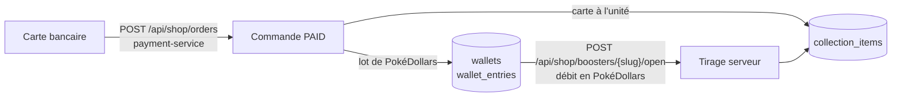

# Processus des PokéDollars, des boosters et de la collection

PokéBling vend deux choses en euros, par carte bancaire (via `payment-service`) : des cartes Pokémon à l'unité
et des lots de **PokéDollars**, sa monnaie virtuelle. Les PokéDollars servent uniquement à ouvrir des
**boosters**. Les cartes, achetées ou tirées, rejoignent la **collection** du client. Code :
`services/shop-service/app/wallet_service.py`, `booster_service.py`, `collection_service.py`.

## Vue d'ensemble



Seul l'achat en euros passe par `payment-service`. L'ouverture d'un booster est une opération interne à
`shop_db` : une panne de la plateforme de paiement n'empêche pas d'ouvrir des boosters avec un solde existant.

## Achat de PokéDollars

1. Le client met un lot dans son panier (`pokedollars-500`, `-1200`, `-2600`, `-7000`) et paie la commande
   comme n'importe quel article (`processus-commande-et-paiement.md`).
2. Dans la transaction SQL qui enregistre la commande, `shop-service` verrouille le porte-monnaie du client
   (`SELECT … FOR UPDATE`, créé au besoin), ajoute le montant et écrit une ligne `wallet_entries`
   (`reason = PURCHASE`, `reference = CMD-…`).
3. Si la commande ne peut pas être enregistrée, rien n'est crédité et le client est remboursé (compensation).

Taux de base : 100 PokéDollars par euro, avec un bonus de 20 à 40 % sur les gros lots. Les lots ont un stock
illimité.

## Ouverture d'un booster

`POST /api/shop/boosters/{slug}/open`, en une seule transaction SQL :

1. **Verrou du porte-monnaie** de l'utilisateur : ses ouvertures passent une par une, deux onglets ne peuvent
   pas dépenser deux fois le même solde.
2. **Idempotence** : si l'en-tête `Idempotency-Key` (UUID choisi par le navigateur) a déjà servi à cet
   utilisateur, la même ouverture est renvoyée sans nouveau débit (double clic, relance après une coupure).
   La même clé pour un autre booster : 409.
3. **Solde** : s'il est inférieur au prix, 409 `Solde insuffisant : il vous manque N PokéDollars`.
4. **Tirage côté serveur** avec `secrets.SystemRandom` (générateur du système, imprévisible) : pour chaque
   emplacement du booster, une rareté est choisie selon ses poids, puis une carte de cette rareté parmi les sets
   du booster, sans doublon dans le même paquet. Le navigateur ne choisit rien.
5. **Écritures** : débit (`wallet_entries`, `reason = BOOSTER`), ajout des cartes à `collection_items`
   (`INSERT … ON CONFLICT DO UPDATE`), historique dans `booster_openings` (cartes dans l'ordre de révélation,
   cartes nouvelles pour le client), puis `COMMIT`.
6. Métriques `shop_boosters_opened_total{booster}` et `shop_pokedollars_total{movement="spent"}` ; journal
   `Booster ouvert : user=<uuid> booster=<slug> cartes=<ids>`.

Le solde ne peut pas devenir négatif : la base l'interdit (`ck_wallet_balance_non_negative`) en plus du contrôle
applicatif.

## Probabilités affichées

Chaque booster est une liste d'emplacements `{rareté: poids}`. Exemples :

| Booster | Emplacements |
|---------|--------------|
| Set de Base, Jungle, Fossile | 3 × commune, 2 × peu commune, 1 × {rare : 2, holo : 1} |
| 151, Évolutions Prismatiques | 3 × commune, 1 × peu commune, 1 × variante {commune 50, peu commune 30, ultra 15, secrète 5}, 1 × {rare 72, holo 22, ultra 5, secrète 1} |
| Légendaire (5 sets) | 2 × holo, 2 × {holo 70, ultra 30}, 1 × {ultra 75, secrète 25} |

Une rareté absente des sets du booster est ignorée (les anciens sets n'ont pas d'ultra rare). `GET
/api/shop/boosters` publie pour chaque rareté la probabilité d'en obtenir au moins une par booster :
`1 − Π (1 − p_emplacement)`. Sur 20 000 tirages simulés, l'écart entre fréquence observée et probabilité publiée
est resté sous 0,5 point.

## Collection

- Une ligne `collection_items` par carte possédée, avec le nombre d'exemplaires.
- `GET /api/shop/collection` : cartes différentes possédées sur 609, exemplaires, valeur au prix de la boutique,
  avancement par set. La page Collection affiche toutes les cartes du set choisi, les manquantes en grisé avec
  un lien pour les acheter à l'unité.

## Annulation d'une commande et PokéDollars

Une commande annulée reprend ce qu'elle a livré : PokéDollars débités (`reason = REFUND`), cartes retirées de la
collection. Si le solde actuel est inférieur aux PokéDollars achetés (déjà dépensés en boosters), l'annulation
est refusée (409) **avant** tout remboursement : pas de remboursement en euros de PokéDollars déjà utilisés.
Voir `processus-annulation-et-remboursement.md`.

## Vérifications utiles

```sql
-- Solde et journal d'un utilisateur cohérents (doit renvoyer 0 ligne)
SELECT w.user_id, w.balance, COALESCE(SUM(e.amount), 0) AS somme
FROM wallets w LEFT JOIN wallet_entries e ON e.user_id = w.user_id
GROUP BY w.user_id, w.balance HAVING w.balance <> COALESCE(SUM(e.amount), 0);

-- Dernières ouvertures
SELECT opened_at, user_id, price, card_ids FROM booster_openings ORDER BY opened_at DESC LIMIT 10;
```
