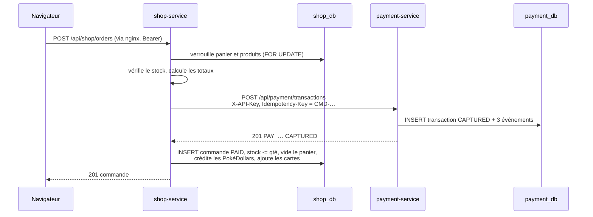

# Processus de commande et de paiement

Ce qui se passe quand un client clique sur « Payer » : `shop-service` transforme le panier en commande et fait
débiter la carte par la plateforme de paiement `payment-service`. C'est le parcours qui produit les
transactions, et celui qu'on rejoue pour prouver la reprise après incident. Code :
`services/shop-service/app/order_service.py` (`checkout`) et `services/shop-service/app/payment.py` (`charge`).

## Schéma de séquence du paiement

## Étapes du paiement côté shop-service

1. **Verrouillage du panier** : les lignes de `cart_items` du client sont verrouillées. Panier vide : 400.
2. **Verrouillage des produits** : `SELECT … FOR UPDATE`, triés par id pour éviter les interblocages. Deux
   clients ne peuvent pas acheter le dernier exemplaire en même temps.
3. **Contrôle du stock** : s'il manque du stock pour au moins un article, 409
   `Stock insuffisant pour : <noms>`, rien n'est débité.
4. **Calcul** : prix lus en base, lignes figées (nom, prix), total, PokéDollars à créditer.
5. **Numéro de commande** : `CMD-AAMMJJ-XXXXXX` (date UTC + 6 caractères hexadécimaux aléatoires).
6. **Débit** : appel de `payment-service` (voir section suivante). Pendant cet appel, panier et produits
   restent verrouillés.
7. **Enregistrement et livraison** : commande `PAID` avec `card_last4` et `payment_reference`, décrément du
   stock des cartes, suppression des lignes du panier, crédit des PokéDollars (porte-monnaie verrouillé, ligne
   `wallet_entries` `PURCHASE`) et ajout des cartes à la collection, puis un seul `COMMIT`.

## Appel de shop-service vers payment-service

`shop-service` appelle `POST http://payment-service:8000/api/payment/transactions` avec :

- `X-API-Key` : clé du marchand PokéBling (`PAYMENT_API_KEY`) ;
- `Idempotency-Key` : le numéro de commande ;
- corps : `amount` (total), `currency` `EUR`, `merchant_reference` (numéro de commande), `card`.

Seuls `card_last4` et la référence `PAY_…` sont conservés par PokéBling : le numéro complet et le CVC ne font
que transiter en mémoire.

## Délais et nouvelles tentatives vers payment-service

| Réglage | Valeur | Rôle |
|---------|--------|------|
| Délai de connexion | 1 s | `payment-service` arrêté ou injoignable |
| Délai de réponse | 3 s par tentative (`payment_timeout`) | `payment-service` lent ou bloqué |
| Tentatives | 2 (`payment_attempts`) | Nouvel essai après une erreur réseau ou un code 5xx |
| Pause entre tentatives | 0,3 s | – |

Une réponse en 4xx n'est jamais retentée. La nouvelle tentative est sans risque de double débit : elle porte
la même `Idempotency-Key`, et `payment-service` renvoie la transaction d'origine si la première demande avait
en fait abouti. Après 2 échecs, le client reçoit 503 entre 0,3 s (conteneur arrêté) et environ 6,3 s
(service bloqué) après son clic.

## Issues possibles du paiement

| Réponse de payment-service | Réponse au client | Débité ? | Commande | Panier |
|----------------------------|-------------------|----------|----------|--------|
| 201 ou 200 avec `CAPTURED` | 201 commande | oui | créée `PAID` | vidé |
| 402 carte refusée | 402 avec le motif de la banque | non | aucune | conservé |
| Injoignable ou 5xx, 2 fois | 503 | non | aucune | conservé |
| 401 (mauvaise clé API), 409, 422 ou statut inattendu | 502 `Le paiement n'a pas pu être traité` | non | aucune | conservé |
| 201 puis échec du `COMMIT` PokéBling | 500 | remboursé aussitôt | aucune | conservé |

En cas d'échec avant le débit, `shop-service` annule sa transaction SQL : les verrous sont libérés et rien
n'est modifié dans `shop_db`.

## Mode dégradé : payment-service indisponible

Si `payment-service` ne répond pas, PokéBling continue de fonctionner sans lui :

- catalogue, fiches produit, panier et connexion restent utilisables ;
- `POST /api/shop/orders` répond 503
  `Le service de paiement est momentanément indisponible, veuillez réessayer dans quelques instants` ;
- rien n'est débité, aucune commande n'est créée, le panier est conservé ;
- `shop-service` journalise `payment-service injoignable (tentative 1/2) : …` puis `(tentative 2/2)`.

Après la reprise, le client peut repayer le même panier : un nouveau numéro de commande est généré.

## Compensation : débit sans commande enregistrée

Si la carte a été débitée mais que la commande ne peut pas être enregistrée dans `shop_db` (erreur au
`COMMIT`), `shop-service` :

1. annule sa transaction SQL ;
2. journalise `Commande CMD-… non enregistrée après le paiement PAY_… : remboursement` (avec la trace) ;
3. appelle `POST /api/payment/transactions/PAY_…/refund` ;
4. si ce remboursement échoue aussi, journalise
   `Remboursement de compensation impossible pour PAY_… : à régulariser` ;
5. répond 500 au client.

Le cas 4 laisse une transaction `CAPTURED` sans commande PokéBling : il se détecte par rapprochement des deux
bases (voir `metriques-journaux-et-signaux.md`).

## Preuve de reprise par une nouvelle transaction

Une commande payée avec la carte `4242 4242 4242 4242` prouve que toute la chaîne fonctionne. Pour un test
répétable, acheter un lot de PokéDollars (`pokedollars-500`, stock illimité) plutôt qu'une carte, dont le stock
s'épuise. Elle prouve : nginx,
`auth-service` (JWT), `shop-service`, `shop_db`, `payment-service` et `payment_db`. Traces attendues :

- nginx (`frontend`) : `"POST /api/shop/orders HTTP/1.1" 201` ;
- `payment-service` : `transaction reference=PAY_… merchant=novashop merchant_reference=CMD-… status=CAPTURED …` ;
- en base : une ligne `CAPTURED` récente dans `payment_db.transactions` et une commande `PAID` dans
  `shop_db.orders` avec la même référence `PAY_…`.

Un conteneur redémarré ou une sonde `/health` verte ne suffisent pas : la sonde n'interroge pas la base.
