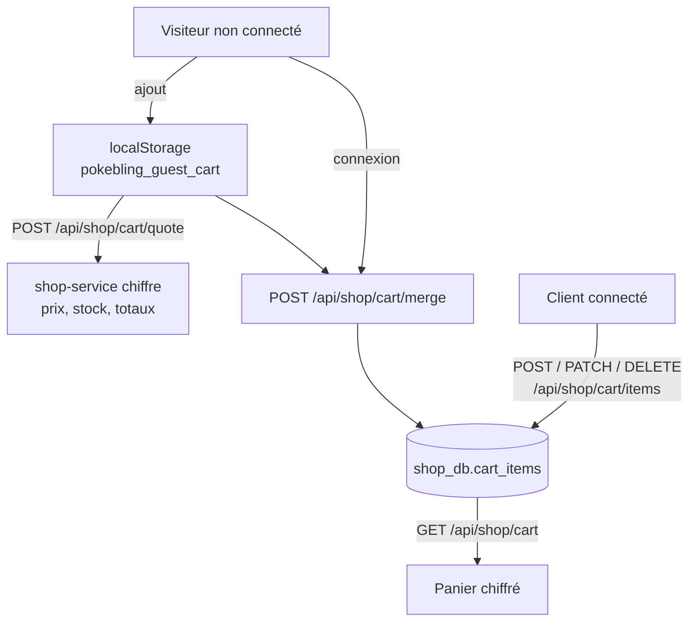

# Processus du panier PokéBling

Le panier de PokéBling est **hybride** : chez un visiteur non connecté, il vit dans le navigateur ; chez un
client connecté, il est stocké par `shop-service` dans `shop_db`. Les deux sont fusionnés à la connexion.
Code : `frontend/src/context/CartContext.jsx`, `services/shop-service/app/cart_service.py`.

## Schéma du panier hybride

## Panier d'un visiteur non connecté

1. À chaque ajout, le front lit `pokebling_guest_cart` dans `localStorage` (lignes `{product_id, quantity}`).
2. Il vérifie localement le plafond de 10 exemplaires et le stock connu de la fiche produit.
3. Il appelle `POST /api/shop/cart/quote` avec les lignes : `shop-service` renvoie prix, stocks et total
   réels, et ce qui sera livré (PokéDollars, nombre de cartes). Rien n'est écrit en base.
4. Le front enregistre les nouvelles lignes dans `localStorage` et affiche le panier chiffré.

Le navigateur ne fournit jamais de prix : seuls l'identifiant du produit et la quantité sortent du poste.

## Fusion du panier invité à la connexion

1. Après la connexion, si `pokebling_guest_cart` n'est pas vide, le front le vide aussitôt et envoie son
   contenu à `POST /api/shop/cart/merge`.
2. Pour chaque produit, `shop-service` fixe la quantité à
   `min(quantité déjà au panier + quantité invitée, stock, 10)`.
3. Produits inconnus ou en rupture : ignorés sans erreur.
4. Si l'appel échoue, le front remet le panier invité dans `localStorage` pour ne rien perdre.

## Panier d'un client connecté

Chaque ligne est un enregistrement de `cart_items` (`user_id`, `product_id`, `quantity`), unique par couple
utilisateur-produit. Les routes `POST /api/shop/cart/items`, `PATCH /api/shop/cart/items/{product_id}`,
`DELETE /api/shop/cart/items/{product_id}` et `DELETE /api/shop/cart` modifient la base puis renvoient le
panier complet recalculé.

## Règles de calcul du panier

- **Prix et stock** : toujours lus en base par `shop-service`.
- **Quantité** : 1 à 10 par article (`max_quantity_per_item`). Au-delà : 409
  `Maximum 10 exemplaires par article`.
- **Stock** : une quantité supérieure au stock est refusée à l'ajout ou à la modification (409). Si le stock
  baisse après coup, la ligne reste dans le panier avec `available: false` et bloque le paiement.
- **Ligne** : `line_total = prix × quantité`, arrondi au centime.
- **Articles** : cartes à l'unité (`kind = CARD`, stock limité) et lots de PokéDollars (`kind = POKEDOLLARS`,
  stock `null` = illimité, jamais en rupture). Les boosters ne passent pas par le panier : ils se paient en
  PokéDollars, à l'ouverture.
- **Total** : somme des lignes. Pas de frais de port, tout est numérique. `pokedollars` et `cards_count`
  indiquent ce qui sera livré au paiement.

## Le panier pendant le paiement

Au paiement (`POST /api/shop/orders`), les lignes du panier sont verrouillées (`SELECT … FOR UPDATE`) le temps
de la transaction. Un double clic sur « Payer » attend la fin de la première requête, puis trouve un panier
vide (400 `Votre panier est vide`) : une seule commande est créée. Si le paiement échoue (402, 503…), le panier
est conservé intact. Voir `processus-commande-et-paiement.md`.

## Panier et panne de payment-service

Le panier ne dépend pas de `payment-service`. Si la plateforme de paiement est indisponible, les clients
peuvent toujours consulter le catalogue et remplir leur panier ; seul le paiement répond 503.
